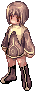

# Baby Characters

Start over as a pint-sized adventurer. On uaRO any Novice or first class can become a baby character for a fee, with no couple and no adoption needed.

!!! info npc-facts "Quick Facts"
    

    - **NPC:** Sister Elara
    - **Location:** Prontera Church, `/navi prt_church 177/23`
    - **Cost:** 5,000,000z
    - **Adoption:** Not required
    - **Who Can Become a Baby:** Novice and first classes

## How It Works

- You become a baby on your own, with **no adoption** by a couple.
- Only **Novice and first classes** can become a baby, including Ninja, Taekwon, Gunslinger and Super Novice.
- Second classes and above can't, including Soul Linker and Star Gladiator.
- Babies can change to a second class as usual, but **can't transcend** at Base Level 99.
- If you become a baby while still a Novice, you **can't change class**.
- Baby characters can raise a stat to 99 base instead of the official cap of 80, see [Class Changes](class-changes.md#adoptee).

!!! warning "Choose Before You Pay"
    Baby characters can't transcend, and a baby Novice can't change class. Decide on your class path before you pay the 5,000,000z.
