# uaRO Beginner's Info & Quick Start Guide

A quick-start guide for new uaRO players covering the server's key features, a short class overview and a fast route to level 60+. It was originally written by Angebo. There have been edits by the Wiki maintainers.

Discord is your best resource for player guides. Check out the "Class Theory" category. [Join Discord](https://discord.gg/Zn6jrQy9x).

## About this Guide
This guide will contain basic information on how to have a good start at uaRO. It provides an overview about important features and where to find information. There is a short class overview and a Quick Starter guide which can push you up to 60+ within a short time. It ends with some suggestions where to make your first small funds.

!!! tip "What to Do First"
    1. Pick a class and create your character ([Choosing Your First Class](#choosing-your-first-class)).
    2. Finish the [Novice Grounds](remastered-novice-location.md) and change to your first class.
    3. Learn your class quest skills from the Platinum Skill NPC in the [Main Office](main-office.md).
    4. Hire a [Mercenary](mercenary-system.md) and level with the [Quick Start Guide](#quick-start-guide).
    5. Change to your second class at job 40.

## Important uaRO Features

### Autoloot
An important feature to know about is `@autoloot`, which is configured with `@lootconfig`. If you want to know more about how to configure it, look in the **[commands list](commands.md)**. This feature really boosts the farming ability and efficiency of ranged and or AoE based classes a lot: After killing a target, they do not need to close the distance to collect the loot. This is 1-4 seconds less time to spend after killing.

### Increased Sight
The sight range is increased so you are allowed to scroll out further than usual.
This allows you to use ranged skills like DS to its fullest, buffing Bow classes. In addition it's easier to mob and avoid enemies you dislike.

!!! note
    For Archer and Rogue: DS has a 3 cells higher range than your auto attacks. If you DS on max range and then try to AA, your character will run “weird” because your target is out of range.

### Rodex Mail System
You can send items to and from everywhere for a small fee of 2,500z per item stack. So you can restock consumables and send your loot away wherever you want. You have to care less for weight limit because your solution is only a few seconds away. You can send more than one mail and open them one after the other when you want, they are stored for 14 days. You can only send tradeable items this way, not account bound ones.

[Read more about the Mail System](improvements.md#rodex-mail-system).

!!! warning
    It is said that it is possible to lose the items in the mail system. If this happens, go to the Discord, and use the channel `#submit-ticket`. Do not send important or expensive items this way.

!!! note
    You can not send Great Nature (`997`) this way.

###  [Poring Coins (PC)](poring-coins-system.md)
Most enemies have a 5% Chance to drop an item called Poring Coin (`7539`), making high kill count valuable by itself. They have various use cases.

#### Zeny
They sell well to players and always will. Sell them whenever you need some zeny fast.

####  Field Manual - 100%
Doubles your base exp. A great help while leveling. They double exp gained through quests as well, important for repeatable EXP quests.

####  Gym Pass
Adds +200wt carry capacity, when redeemed to Ripped Cabus (Payon- 173,141). Up to 10 total can be redeemed. Revisit Ripped Cabus at any time, if for whatever reason you lose it, and he will restore it free of charge!

####  Infinite Fly Wing
0 Weight, account bound, can be used infinite amount and time. A lot of people name the IFW a “game changer”. Tho none was ever able to explain what it actually changes. You still can use normal Fly Wings from the NPC and transfer them easily with the rodex mail system. As a beginner, getting some equipment is more important than a QOL (quality of life) item.

#### [Quest Headgears](dimonka-headgear-quest.md)
There are various powerful headgears you can craft using Poring Coins, for example Rideword and Chick Hat.

### [Elemental Converter](https://irowiki.org/w/index.php?title=Create_Elemental_Converter&oldid=47391)
The item “Elemental Converter” endows your weapon with one of the four elements, fire, water, wind or earth - like Endow. Other than the item description they last for 30 minutes and are sold by players for around 5,000z to 10,000z. These allow you to not care for elemental weapons or arrows, except some rare use cases (or f.e. Holy).

### [Card Exchanger](card-exchange.md)
Cards can be traded for points and exchanged for Bloody Branches (`12103`) or Old Card Album (`616`). So any card has at least a basic value.

###  Myst Case Card
The drop chance for 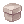 Gift boxes from Myst Case Card is increased, making it a good farming item - the more you kill, the better.

### [Warper System](warper-system.md)
Once you finish a Dungeon access quest you can unlock a Warpra helper. This allows you to always warp there with all your characters of this account for a fee of 5,000z.

### [Inn Buffs](improvements.md#superior-inns)
Using an Inn costs 10,000z and gives you Agi Up and Blessing 10 for 10 Minutes. This is very useful if you level on maps you can access very fast, close to a town, with a warp if you are Aco Class, or with Warpra.

### [Sitting Regeneration](improvements.md#increased-natural-recovery)
If you sit, after 10 seconds you have a super regeneration that fills your HP / SP very fast. This values SP pool over SP regeneration at least for solo leveling. For mass parties you still want to have regeneration.

### Party Features

#### Party EXP Bonus
For every member in the party, all get a +15% Exp Bonus. So at a full party, all get 280% Exp instead of 100%.
This change values the party size: filling a party with classes that don't contribute much still is an improvement. For example, the 12th person takes 1/12 = -8.3% Exp. Their bonus alone offers 280/265-1 = +5.7% exp.
One special use case are parties like Sleeper Parties, where everyone levels on their own (and items are not shared) but they share Exp - even If the kill count differs, everyone levels faster than on their own.

#### Idle Mechanic
Exp and Item sharing is disabled for idle members after 60 seconds. You are idle when you don't make an input, like moving or skill usage. In order to be counted as active, you need to use a skill other than First Aid and move at least one cell.

### [Repeatable EXP Quests](repeatable-quests.md)
These are important for three reasons:

- Most Exp items can be sold to players for a reasonable price, so it's a possible source of money.
- The Killing Quests can help you to level faster (namely Alligator, Dryad, and Remover).
- Once you rebirth, you will have a lot of Huge and Sharp Leaf (Pinguicula (`1995`) drop them). They will help you to become a higher level really quick.

###  Platinum Skill NPC
Class quest skills (platinum skills) are learned from the Platinum Skill NPC in the [Main Office](main-office.md) in Prontera, without doing the quest. Visit this NPC after every job change to pick up the skills your class is missing. For example, a Thief gets Back Slide and a Merchant gets Cart Revolution.

###  Reset NPC
This NPC is located in the Prontera Main Office and allows you to reset your skills, your stats, or your skills and stats. You can do it as often as you like for a fee, with the first time being free. This allows you to first choose a beginners friendly build and once you own the money (and equipment) you can change to a late game one.

## Sources of Information

### [uaRO Discord](https://discord.gg/BNYnsDfnzN)
If you have questions you are unable to answer with the other sources or want contact with Server Staff, this is your way to go. It also has a channel for each basic class where you can ask about guides, builds and so on. Feel free to not blindly trust others but ask until you understand. It also has a very detailed, player made resources. There is a static link on the [uaRO main page](https://uaro.net/).

### [uaRO Wiki](https://wiki.uaro.net/site/)
There is interesting information in it, and is recommended to read.

### [Classic Wiki](https://irowiki.org/classic/Main_Page)
Note: Always take care if there is “classic” in the link. If not, if it’s called “wiki”, the information is related to the Renewal version and often incorrect.

This site contains a ton of information about game mechanics and quests. Aside that, it has a builds chapter for every class where you can read information about common (and less common) builds, which stats and skills they rely on, and which advantages and disadvantages they have.

### [RMS – Rate My Server](https://ratemyserver.net/)
This site is a big database for items, monsters, skills and quests. Most of these are available in uaRO. You can search for equipment and monsters by specific attributes (like their element) and check the maps they are on. Monsters have a “Skill Analysis” tab that tells you under which conditions which skills are used. There is a World Map as well.

### [Rocalc](https://rocalc.com/)
This is the best calculator available, and it generally fits to uaRO with some exceptions. If you want to compare equipment, builds and ideas, this is your way to go.

### [Skillsim](https://skills.irowiki.org)
You can plan your skill tree at this site. Please note that it has a renewal skill tree, but they are mostly correct pre renewal as well. The only known change is: Lord Knight needs Spear Mastery 10 (instead of 5) for Spiral Pierce.

## Choosing Your First Class
Beginner friendly classes are the ones that don't need good, expensive equipment to perform: they either have access to cheap-and-good gear (Archer and Swordman) or don’t rely on equipment (SL, Ninja, Priest). The cards below run from most to least beginner friendly. Each shows the class's path from first class to second class to transcendence, whether it fights in melee, at range or with magic, and whether it plays best solo or in a party.

!!! warning "Subjective and Player Written"
    This information is highly subjective, so try out the classes that interest you and ask questions. The recommended guides are player written and may be out of date, so confirm them before making expensive commitments.

Thief and Mage have guides that cover the whole branch: [Angebo's Starting from Scratch](https://discord.com/channels/702960460168953946/1442687152872886323) for Thief and [Marito's How to Easy Mage](https://discord.com/channels/702960460168953946/1442641145891913899) for Mage.

### Recommended

-   { .class-sprite }→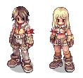{ .class-sprite }

    **Sniper**{ #sniper } Ranged Solo Party

    *Archer → Hunter → Sniper*

    Ranged damage dealer built around Double Strafe (DS) with high DEX, medium AGI and medium INT. It can one-hit several targets. The Orc Archer Bow (`1734`) is cheap and powerful, especially with an Elemental Converter. Level and earn Zeny at Hill Winds.

    [Job change guide ↗](https://irowiki.org/classic/Hunter_Job_Change_Guide) · [Recommended player guide ↗](https://discord.com/channels/702960460168953946/1507939786860527666)

-   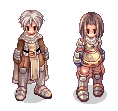{ .class-sprite }→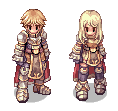{ .class-sprite }

    **Lord Knight**{ #lord-knight } Melee Solo

    *Swordman → Knight → Lord Knight*

    Melee farmer built around Bowling Bash (BB) or Brandish Spear, with a STR / AGI build, because Flee helps a beginner more than VIT. The Ahlspiess (`1478`) is cheap and kills high DEF monsters fast. Level and earn Zeny at [Sleeper](#hunt-sleeper).

    [Job change guide ↗](https://irowiki.org/classic/Knight_Job_Change_Guide) · [Recommended player guide ↗](https://discord.com/channels/702960460168953946/1517220731908526261)

-   { .class-sprite }

    **Ninja**{ #ninja } Magic Solo

    *Novice → Ninja*

    Ranged magic damage dealer with some protection skills. It needs little equipment and no consumables except stones, which are cheap at the left Inn in Prontera. Level and earn Zeny at Pinguicula.

    [Job change quest ↗](https://irowiki.org/classic/Ninja_Job_Change_Quest) · [Recommended player guide ↗](https://www.youtube.com/watch?v=QoWpbmxxxIA)

-   { .class-sprite }

    **Soul Linker**{ #soul-linker } Magic Solo Support

    *Taekwon Kid → Soul Linker*

    Single target magic damage dealer built around Esma Bolt. It survives well and needs no equipment, but relies on Mercenaries until you have Esma. Level and earn Zeny at Pinguicula, then explore the world, Glast Heim (GH) for example.

    [Job change guide ↗](https://irowiki.org/classic/Soul_Linker_Job_Change_Guide) · [Recommended player guide ↗](https://discord.com/channels/702960460168953946/1522653888786857994)

-   { .class-sprite }

    **Gunslinger**{ #gunslinger } Ranged Solo

    *Novice → Gunslinger*

    Ranged damage dealer that works a lot like Hunter. It can start farming certain areas really quickly, and with the right strategies it is just as effective as Hunter.

    [Job change quest ↗](https://irowiki.org/classic/Gunslinger_Job_Change_Quest) · [Recommended player guide ↗](https://discord.com/channels/702960460168953946/1543702504787673098)

-   { .class-sprite }→{ .class-sprite }

    **Stalker**{ #stalker } Melee Ranged Magic Solo

    *Thief → Rogue → Stalker*

    Good farmer, but it loses to Archer: there is no cheap and good weapon for Thief classes, and range is a big advantage with autoloot. It still levels fast with a Bow and BB or a Magic build. Other classes are friendlier to beginners.

    [Job change guide ↗](https://irowiki.org/classic/Rogue_Job_Change_Guide) · [Recommended player guide ↗](https://discord.com/channels/702960460168953946/1242465780499611721)

### Okay

-   { .class-sprite }→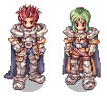{ .class-sprite }

    **Paladin**{ #paladin } Melee Solo Party Support

    *Swordman → Crusader → Paladin*

    Melee damage dealer built around Grand Cross (GC), a large AoE skill that also damages you. It is less intuitive and less beginner friendly than Knight, but a good guide makes you effective quickly.

    [Job change guide ↗](https://irowiki.org/classic/Crusader_Job_Change_Guide) · [Recommended player guide ↗](https://discord.com/channels/702960460168953946/1513593872159342822)

-   { .class-sprite }→{ .class-sprite }

    **Clown / Gypsy**{ #clown-gypsy } Ranged Party Support

    *Archer → Bard / Dancer → Clown / Gypsy*

    Ranged support classes similar to Hunter, with a higher SP pool and support songs. They are heavily requested in leveling parties, so they are easy and fast to level.

    [Job change guide (Bard) ↗](https://irowiki.org/classic/Bard_Job_Change_Guide) · [Job change guide (Dancer) ↗](https://irowiki.org/classic/Dancer_Job_Change_Guide) · [Recommended player guide ↗](https://discord.com/channels/702960460168953946/1535596146724970496)

-   { .class-sprite }→{ .class-sprite }

    **Assassin Cross**{ #assassin-cross } Melee Solo

    *Thief → Assassin → Assassin Cross*

    Melee damage dealer. End builds are expensive, but cheap options exist: Grimtooth needs nothing but a weapon, and DA-Katar starts fine with a cheap weapon. Avoid crit or dagger builds with no funds.

    [Job change guide ↗](https://irowiki.org/classic/Assassin_Job_Change_Guide) · [Recommended player guide ↗](https://discord.com/channels/702960460168953946/1235750571638521977)

-   { .class-sprite }→{ .class-sprite }

    **High Wizard**{ #high-wizard } Magic Solo Party

    *Mage → Wizard → High Wizard*

    Magic damage dealer that levels in parties, or solo with vertical fire wall. Beyond that you are limited, and Ninja and Soul Linker are friendlier magic classes for beginners.

    [Job change guide ↗](https://irowiki.org/classic/Wizard_Job_Change_Guide) · [Recommended player guide ↗](https://discord.com/channels/702960460168953946/1459831652522922249)

-   { .class-sprite }→{ .class-sprite }

    **High Priest**{ #high-priest } Magic Party Support

    *Acolyte → Priest → High Priest*

    Support class that relies on party play, so it is not recommended as a first class. With little gear it learns Turn Undead (TU) and levels in Anubis and later Old Glast Heim (OGH). Its support skills let it use mercenaries much longer than other classes.

    [Job change guide ↗](https://irowiki.org/classic/Priest_Job_Change_Guide) · [Recommended player guide ↗](https://discord.com/channels/702960460168953946/1472985081328177193)

-   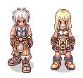{ .class-sprite }

    **Super Novice**{ #super-novice } Melee Magic Solo Party

    *Novice → Super Novice*

    Very unique class with a lot of things you can do, but it has a learning curve and is not the easiest first character.

    [Job change guide ↗](https://irowiki.org/classic/Super_Novice_Job_Change_Guide) · [Recommended player guide ↗](https://discord.com/channels/702960460168953946/1453772909507121183)

### Not Recommended

-   { .class-sprite }→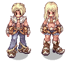{ .class-sprite }

    **Whitesmith**{ #whitesmith } Melee Solo

    *Merchant → Blacksmith → Whitesmith*

    Melee class that relies on auto attack, which is slow, while its primary attack skill costs Zeny. Not recommended over Knight or Hunter.

    [Job change guide ↗](https://irowiki.org/classic/Blacksmith_Job_Change_Guide) · [Recommended player guide ↗](https://discord.com/channels/702960460168953946/1491175245800017982)

-   { .class-sprite }→{ .class-sprite }

    **Creator**{ #creator } Melee Ranged Solo Party

    *Merchant → Alchemist → Creator*

    Support class with complex and expensive mechanics that are not beginner friendly.

    [Job change guide ↗](https://irowiki.org/classic/Alchemist_Job_Change_Guide) · [Recommended player guide ↗](https://discord.com/channels/702960460168953946/1530194537589510195)

-   { .class-sprite }→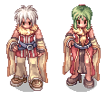{ .class-sprite }

    **Professor**{ #professor } Magic Party Support

    *Mage → Sage → Professor*

    Support class that is even worse than Wizard as a starting class. Best used as a party support in the mid to late game.

    [Job change guide ↗](https://irowiki.org/classic/Sage_Job_Change_Guide) · [Recommended player guide ↗](https://discord.com/channels/702960460168953946/1510303611563806852)

-   { .class-sprite }→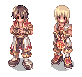{ .class-sprite }

    **Champion**{ #champion } Melee Solo Party

    *Acolyte → Monk → Champion*

    Melee class. Investigation Monk is useful at Sleeper but needs notable funds, and Knight is a better choice. Combo Monk lacks a proper beginner weapon. Steel Body makes you a medium requested tank for mass parties.

    [Job change guide ↗](https://irowiki.org/classic/Monk_Job_Change_Guide) · [Recommended player guide ↗](https://discord.com/channels/702960460168953946/1199400754310545599)

-   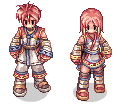{ .class-sprite }

    **Star Gladiator (SG)**{ #star-gladiator-sg } Melee Solo

    *Taekwon Kid → Star Gladiator*

    Popular as a later game farming class. In the early game, other classes like Hunter or Knight are better.

    [Job change quest ↗](https://irowiki.org/classic/Star_Gladiator_Job_Change_Quest)

## Quick Start Guide
This chapter focuses on leveling up to 50-60+ fast so you can become your second class soon. It can be done with any class, because it uses Mercenaries.

Mercenaries are a helpful tool for beginners because they offer quite some strength in early levels, but they drop off soon around level 60. That is when you can begin to stand on your own.

!!! note
    This guide focuses on using mercenaries from the start. You can start immediately with [Repeatable EXP Quests](repeatable-quests.md) instead if you prefer.

### Create Your Character
First decide which job you want to take. Then create a new character, choose name and hair style. Start.

!!! note
    Check your hairstyle in game, it might vary. You can change your hair style and color freely [in Prontera at the Stylist](custom-npc.md) later on. Changing cloth color costs zeny.

### Novice Grounds
Start with the [Novice Grounds](remastered-novice-location.md). You can collect some early zeny here and gain EXP to get to first class. If you can, save up at least 7,000z.

### First Class Job Change Quest
Every class article in the external classic wiki has a job change guide included. If you prefer a video instead go to youtube and search for the class job change guide. Follow the guide and change your job. [Read the Classes Job List](https://irowiki.org/classic/Classes) and familiarize yourself with server [class changes](class-changes.md).

First class job change guides: [Swordman](https://irowiki.org/classic/Swordman_Job_Change_Guide), [Archer](https://irowiki.org/classic/Archer_Job_Change_Guide), [Thief](https://irowiki.org/classic/Thief_Job_Change_Guide), [Merchant](https://irowiki.org/classic/Merchant_Job_Change_Guide), [Mage](https://irowiki.org/classic/Mage_Job_Change_Guide), [Acolyte](https://irowiki.org/classic/Acolyte_Job_Change_Guide) and [Taekwon Kid](https://irowiki.org/classic/Taekwon_Job_Change_Guide).

### Short Information About Mercenaries
[Read about Mercenaries](mercenary-system.md).

Mercenaries are a helpful tool for beginners. Their cost is low and their power high compared to any low-level class without very good equipment. They can push you quickly to level 50 and higher, but then they will fall behind. You can purchase up to lvl 6 scrolls for zeny only, above you need Loyalty. This guide doesn’t go deeper into it, because it is hard to farm loyalty – you will grow too fast in levels – and you should start to be self-dependent after this.

There are three types of Mercenaries:

- Spearman. You get them in Prontera, they have high defense and good HP regeneration.
- Bowman. You get them one map above Payon, they have decent damage and ranged attacks, but not much defense.
- Fencer. You get them in Izlude, they have some flee but less defense and regeneration as spearman does.

### Level 15 - 35
After your job change, talk to the Kafra and warp to Prontera. Save at the Kafra there too, so Butterfly Wings bring you back to Prontera. We have 2 things to do there:

1. Enter the [Main Office](main-office.md) (south-west from prontera fountain; left to where you spawn) and talk to the Platinum Skill NPC. Class quest skills (platinum skills) are learned there, without doing the quest. For example: As a Thief, you want Back Slide and as Merchant you want Cart Revolution.
2. Go to the north-west corner of Prontera and talk to the Mercenary Manager.

!!! tip "Hint"
    Copy `/navi prontera 41/337` in the Chat and follow the arrows on the ground.

That’s what you saved up 7,000z for: Hire Mercenary -> 1st Grade Spear Mercenary -> Yes.

!!! tip "Hint"
    If you have some more zeny, you can talk to the Mercenary Merchant left of it and buy one Mercenary Concentration Potion (`12241`).

After you picked up the Skills and one Scroll, go back to any Kafra (or use one of your Novice Butterfly Wings (`12324`) if you saved in town already). There are a few areas to go now, but Spores (`1014`), one map south of Payon, is a good pick. Now let your mercenary rage on for 30 minutes. Do not attack on your own, because you risk dying and losing your mercenary.

After that, you will be level 25 or higher and have some Strawberry (`578`).

Sell these to players using `@wb Strawberry`. Every single one of them will give you more than 1,000z and provide enough funds to buy your next Scroll: go to Prontera, buy a level 2 scroll, and go back to Payon. Repeat this until you are level 35.

!!! tip "Hint"
    A level 2 Spearman can survive at Wolves (2 maps south of Payon) for a while. They will die but kill some of them. This is faster EXP, but you might need a new one sooner.

### Sidestep: Your First Merchant

!!! note
    If you already have a merchant, skip this part.

Everyone needs a Merchant: Overcharge and Discount spare you quite some money in the long run. It is a helper character, not your main. By now you should take a small break and create one: put some zeny (like 10,000z) in your Bank (CTRL+B) and create a new character, your Overcharge and Discount Merchant. You can start as Novice just as you did before. Put all your stat points into STR. After you hit base 15, leave the Novice Ground and say you want to become a Merchant.

Follow this guide: [Merchant Job Quest](https://irowiki.org/classic/Merchant_Job_Change_Guide)

Buy a Mercenary and kill Spores again. You want at the very least these skills:

- Enlarge Weight Limit 3 (pre-requirement)
- Overcharge 10 (Items sold to NPC give additional 24% zeny)
- Discount 10 (Items bought from NPC cost 24% less)

[Discount Merchant Job Build](https://oldskillsim.irowiki.org/bsm.html?10cAjX93cL)

!!! note
    Discount does only apply for basic NPC stores. It does not decrease the price of mercenary scrolls or potions, nor from player set shops.

!!! note
    Item Appraisal is pointless, because in uaRO all items dropped are already identified.

Your Stat is still STR only for weight limit. After you hit job 24 you can let it rest. If you want, you can continue later with better funds. Bring your Merchant to Prontera, save there, sell your NPC loot to an NPC, and buy the supplies you want, esp. Fly Wings.

### Level 35+
Once you hit base 35, go to Prontera and buy 1 - 2 level 3 Spearman Scrolls and restock some Fly Wings (`601`) from the Tool Dealer. You should have enough zeny to look for your first equipment now. Pantie (`2339`) is cheap body armor and Undershirt (`2522`) is a cheap garment. Search player shops for them with `@ws`, for example:

`@ws Pantie`
`@ws Undershirt`

Now you can go to Wolves, two maps south of Payon. Your Mercenary can deal with them easily and well, and your job again is to move around so they can kill for you. Continue this for 30 minutes until your Mercenary expires. You should be around 45-50 now.

An alternative leveling spot is Payon Cave first floor. Some of them are aggressive, so care for your life. And they do not provide good standard loot.

### Level 50+
Either you go on for another round of Wolves to gather some Strawberries or you switch to higher leveling places. This will also switch your role: Instead of just watching it kill with ease, you have to do your part, because the mercenaries will more and more drop off in strength and don’t survive on their own anymore. If your build has a defensive stat (usually AGI, sometimes VIT) you can push it and follow the “Tank for your Mercenary” strategy.

It’s suggested to buy some Meat (`517`) with your Merchant. It is heavy but the best item in terms of zeny to health ratio.

You can go to Morroc and move to `/navi moc_fild17 208/346`, killing Hodes, but watch out for Frilldoras (`1119`). Don’t forget to take the [Repeatable EXP Quest](repeatable-quests.md).

Ideas for alternative leveling spots:

- Porcellio (`1619`)
- Toy Factory 2. Cruiser (`1248`) and Myst Case Card sells well and can be useful for you, too.
- Geographer (`1368`), in the Lazy Archer Way.
- Les (`1881`) (Hint: use an [Inn Buff](improvements.md#superior-inns) for the extra Flee.)
- Map in front of Orc Dungeon: Orc Ladies (`1273`) (Hint: use an [Inn Buff](improvements.md#superior-inns) here as well), get a card.
- Remover (`1682`), Biolabs 1 (Quest needed). Don’t forget to take the Repeatable Exp Quest. They are slow so you can kill them from a distance using hit and run tactics If you are still too weak to face them.

A bit later:

- Sandman (`1165`)
- Dokebi (`1110`)

### Second Class Job Change Quest
Once you hit Job 40 you can change to your second class. Change as soon as you have all necessary first class skills. [Classes Job List](https://irowiki.org/classic/Classes)

Every class article in the external classic wiki has a job change guide included. If you prefer a video instead go to youtube and search for the class job change guide. Follow the guide and change your job.

After the change, visit the [Platinum Skill NPC](#platinum-skill-npc) in the Main Office again to learn the quest skills of your second class.

### Leveling as Second Job
You can continue with Mercenaries for a while, but soon you’ll have to level on your own. The how and where now depends a lot on your class, build and equipment. This is the point where the Quick Start Guide has to end. You can take a look in class specific guides and the Discord channels to find your way further.

Once you’re 90+ you can give the [Quick Rebirth Guide](https://discord.com/channels/702960460168953946/1443235036999712811) a read. With some preparation you can become 85+ in less than one hour after your rebirth.

## Beginner Money-Making

### High Kill Count
Just kill a lot and gather  Poring Coins. Myst Case Card is a further enhancement to this; it's recommended to get one after basic equipment.

###  Strawberry
You will always find a buying shop somewhere. Wolf (`1013`) and Choco (`1214`) drop them, both can be easily killed by mercenaries.

### Repeatable EXP Quest Items
Earthworm Peeling (`1055`) (Hode (`1127`)), Anolian Skin (`7003`) (Alligator (`1271`)) usually sell well to players. Sharp Leaf (`7100`) and Huge Leaf (`7198`) (early Les, [Finding The Moving Island Quest](https://irowiki.org/classic/Finding_The_Moving_Island_Quest), later Pinguicula [Onward to the New World Quest](https://irowiki.org/classic/Onward_to_the_New_World_Quest), see also [El Dicastes](el-dicastes.md) ) can be sold as well, and they offer good EXP as well.

!!! tip "Hint"
    When you are above 90, save some zeny for your own rebirth. You will need 1,285,000z.

### Toy Factory
Solid NPC stuff and some cards you can use or sell.

###  Great Nature
!!! note
    You can't send GNs by mail, one of a few nerfs. You have to carry them the old way.

#### Hunt Sleeper
Sleeper (`1386`) drop GNs by 75%. Either sell them to players or split them yourself. They are not easy targets; only go there with a fitting class and setup.

#### Split GNs
As soon as you have basic funds, you can make the quest, buy some GNs from players (3,250z or less) and [split them](https://irowiki.org/wiki/Ore_Downgrading). The Green Lives per GN sells for avg 3,650z to NPCs on a Merchant with Overcharge 10. It's a safe return of about 12% over the 3,250z purchase price, and well above the 1,860z an NPC pays for a GN itself with Overcharge 10. Here, the Utan Shaman is much less chatty! You find the **Utan Shaman** in Umbala, and she splits `1` stone or your whole stack at once (see [Quest Changes](quest-changes.md)).

!!! note
    When you farm for items to sell to NPC, check the [Modified Sales Prices](modified-sales-prices.md), as uaRO has some adjustments to item prices.

### Hill Winds
Hill Wind (`1680`) is found on `/navi ra_fild05` (see [Map Changes](map-changes.md)). Bow classes can kill these one-hit with DS and have a solid income by selling the standard loot to the NPC. Melee classes will have a hard time there because of the lack in range.

### Thors Volcano 2
It’s hard to get there, but Knockers (`1838`) are easy to kill and they drop Thorny Buckler (`2124`), Elven Ears (`2286`) and their card.

## Notable Features

### Server Wide Chat
The chats **#main**, **#trade** and **#party** can be accessed everywhere by everyone. They are useful to talk with others, you can ask for information and help. And join or start leveling parties. To write in it, PM the channel as it would be a player.

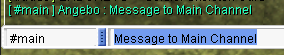

You can easily control what channel you are on [with the command](commands.md): `@channel`.

### Selling and Stuff

[Learn about the Vendor System](vendor-system.md). The command `@autotrade` allows you to set up a store from a different account and play your main one:

- Log into your trading account
- Open your store
- Type `@autotrade` or `@at`
- You get logged out while your merchant stays in-game
- Log into your main (or other) account and play

To open a buying store, [you need to do a small quest](vendor-system.md#create-a-buying-store).

### Navigation System and World Map
[Learn about the Navigation System and World Map](navigation-system.md).

### Bank System

The second icon in the third row, or `CTRL + B`. You can store and transfer zeny between all your characters without a fee to everywhere. Keep at least some zeny on every character to use services like Kafra Storage and Teleport, but to store the main zeny in your bank account, so you can access it easily at any time.

### Guild Storage & Bank

Requirements:
-  Emperium
- 4M base exp (80% tax is max)

How to do it:

1. Use the Emperium (`714`) to create a guild
2. Invite the characters of your choice
3. Tax 2M for first Guild Level
4. Level up “Guild Storage Expansion”
5. Assign a rank with the “Strg Permit” to all characters, who shall access the guild storage

Now you can easily share items between characters of different accounts. There is a guild bank NPC to share zeny found in the market and in Prontera.

### Replay and Screenshot for Reports and Troubleshooting

**[ More information about Replay and Screenshot for Reports and Troubleshooting ](faq.md#screenshot-for-reports-and-troubleshooting)**

### Settings
!!! important "Important Hint"
    A lot of setting changes requires you to start your uaRO Client as admin, else it can not be saved.

Open your game options by pressing ESC.

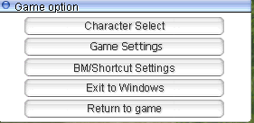

### Battlemode
Click on BM/Shortcut Settings. They look like this:

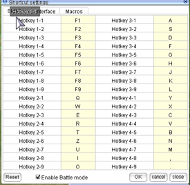

If you have a new client you need to assign the keys for your Battlemode first.

### Shortcuts
They contain a lot of well-known basic commands. Use it as a source of information and don’t change much, because they are often named in guides.

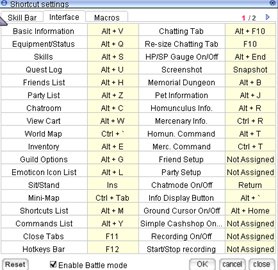

### Chat Macros
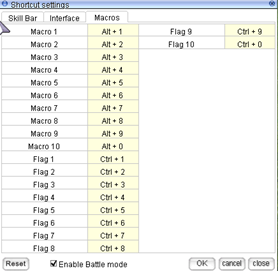

Here you can bind Hotkeys to the Shortcut List, accessible by using ALT + M:

Everything that is inside the box will be sent to your chat immediately. You can bind emoticons to it (which is the basic setting), but also bind `/help`, `/bingbing`, `/doridori` and other chat commands to it.

### Game Settings
You can change some settings in-game, but you have more and better options using the `setup.exe` in your uaRO folder. Just don’t push your screen resolution higher than 1920 x 1080 without having a workaround prepared.