# Dimonka Headgear Quests

Dimonka is found in the [Main Office](main-office.md) and offers a unique selection of practical headgear to support your adventures.

| Headgear | Materials | Description |
|---|---|---|
|  Book of Soyga `19326` |  1000 Poring Coin `7539`  200 Bloody Page `7449`  1000 Worn Out Page `1097` | A magic book with great information. The contents are only deciphered while placing the book upon your head. When equipped with the card below, increases experience gained from defeating monsters of its race by 5%: Armeyer Dinze Card: Fish Anopheles Card: Insect Orc Archer Card: Demi-Human Grove Card: Formless Baroness of Retribution Card: Angel Stem Worm Card: Brute Cloud Hermit Card: Plant Dragon Egg Card: Dragon Wraith Card: Undead Raydric Archer Card: Demon  **Class**: Headgear **Defense**: 0 **Position**: Upper **Weight**: 100 **Level Requirement**: 20 **Jobs**: All  |
| 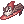 Old Minstrel Song's Hat [1] `18976` |  2000 Poring Coin `7539`  300 Soft Feather `7063`  1000 Fabric `1059` | An old, abandoned minstrel song hat that emanates a mysterious aura. All Stats +1. Increases damage of Arrow Vulcan by 20%. For each 2 refine levels, increases Ranged Physical Damage by 1%.  **Class**: Headgear **Defense**: 3 **Position**: Upper **Weight**: 10 **Level Requirement**: 90 **Jobs**: Clown, Gypsy  |
| 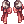 Yin Yang Earrings `18576` |  1200 Poring Coin `7539` 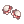 3 Bao Bao `5042`  500 Soft Silk `7166` | These large Earrings carry the balance between Yin and Yang. Increases damage of Chain Combo by 10%. Increases damage of Triple Attack by 5%. Increases damage of Combo Finish by 5%. When equipped with Hot-blooded Headband: Increases damage of Triple Attack and Combo Finish by 5%. Increases damage of Tiger Fist and Chain Crush Combo by 3%.  **Class**: Headgear **Defense**: 0 **Position**: Middle **Weight**: 10 **Level Requirement**: 70 **Jobs**: All  |
|  Spiked Scarf `5462` |  1500 Poring Coin `7539`  5 Red Scarf `10019` 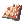 1000 Porcupine Quill `1027` | A scarf with terrifying spikes. Vit +1. Increases damage against Demihuman by 1%. Increases resistance against Demihuman by 1%.  **Class**: Headgear **Defense**: 1 **Position**: Lower **Weight**: 10 **Level Requirement**: 90 **Jobs**: All  |
|  Witch's Pumpkin Hat `18656` |  1200 Poring Coin `7539` 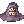 3 Magic Eyes `5138`  1000 Witched Starsand `1061` | A tattered witch hat adorned with a baby pumpkin. Mdef +5. Str +2. Int +2. Increase Magic Damage against Undead and Demon monsters by 15%. Bonus effects when worn with Mr. Smile, Hahoe Mask, Alarm Mask, Opera Mask or Gozarian Mask. Mr. Smile: Adds a chance of gaining Pumpkin Pies when killing monsters. Hahoe Mask: Increased Aspd +5%. Alarm Mask: Increases the healing power of Pumpkin Pie and Well-Baked Cookie. Opera Mask: Increases Flee by 10. Gozarian Mask: Atk and Matk +5.  **Class**: Headgear **Defense**: 1 **Position**: Upper **Weight**: 30 **Level Requirement**: 20 **Jobs**: All except Novice  |
|  Ears of Ifrit `5421` |  1500 Poring Coin `7539` 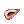 1 Elven Ears `2286`  1000 Burning Hair `7122` | A headgear which imitates Ifrit's ears, the spiritual owner of fire. Str +1, Mdef +3. Increase damage of Fire Bolt, Fire Pillar, and Meteor Storm skill by 2%. Increase damage of Bash, Pierce, and Magnum Break skill by 2%. Increases resistance against Fire elemental attacks by 5%. Decreases resistance against Water elemental attacks by 5%.  **Class**: Headgear **Defense**: 0 **Position**: Middle **Weight**: 0 **Level Requirement**: 70 **Jobs**: All except Novice  |
|  Mitra [1] `5747` |  1500 Poring Coin `7539`  1000 Handcuffs `7345`  1 Margaretha Sorin Card `4364` | A hat which is used for ceremonies by priests. INT +1, VIT +1. MDEF +5. Increases Healing skills effectiveness by 5%. Base INT at least 90: MATK +10  **Class**: Headgear **Defense**: 3 **Position**: Upper **Weight**: 10 **Level Requirement**: 90 **Jobs**: High Priest  |
|  Love Guard [1] `18542` |  1500 Poring Coin `7539`  500 Research Chart `7347`  3 Errende Ebecee Card `4349` | A headdress worn by high level members of warrior clergy members. Increases the effect of received healing by 5%. Increases the effectiveness of your own healing skills by 2%. If refined to +7 or higher, increases the effectiveness of your healing skills by an additional 3%.  **Class**: Headgear **Defense**: 4 **Position**: Upper, Middle **Weight**: 50 **Level Requirement**: 30 **Jobs**: All  |
|  Advanced Assassin Mask `18774` |  1000 Poring Coin `7539`  1 Assassin Mask `5096`  50 Star Crumb `1000` | Dark mask for famous assassins. Calms you down just by wearing it. Critical +1 Increases Critical Damage by 1%.  **Class**: Headgear **Defense**: 0 **Position**: Lower **Weight**: 10 **Level Requirement**: 70 **Jobs**: All  |
|  Beer Hat `5416` |  1200 Poring Coin `7539`  1000 Feather `949`  50 Alcohol `970` | Taste of beer after a showerWow~! Drinking is prohibited for minors! Perfect dodge +5 Enable Level 3 Increase HP Recovery. Enable Level 3 Increase SP Recovery.  **Class**: Headgear **Defense**: 2 **Position**: Upper **Weight**: 60 **Level Requirement**: 18 **Jobs**: All  |
| 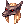 Anubis Helm `5490` |  1500 Poring Coin `7539` 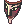 1000 Cultish Masque `1045`  3 Celebrant's Mitten `2617` | This celemonial headdress holds the likeness of Anubis, god of the underworld. Mdef +5 Reduces damage taken from Boss monsters by 10%. Increases restoration gained from Healing skills and Restorative items by 10%  **Class**: Headgear **Defense**: 3 **Position**: Upper  **Weight**: 0 **Level Requirement**: 65 **Jobs**: All  |
|  Puppy Hat `5182` |  1000 Poring Coin `7539`  5 Puppy Headband `5118` 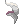 200 Fur `6020` | A small brown-colored dog that sits atop your head. It's so cute you'd be barking mad to remove it. Agi +1 Randomly autocasts Level 1 Gloria when dealing physical attack. If base AGI at least 77: It will cast Level 3 Gloria instead.  **Class**: Headgear **Defense**: 2 **Position**: Upper **Weight**: 50 **Level Requirement**: 30 **Jobs**: All Unrefineable  |
|  Umbala Spirit `18505` |  1500 Poring Coin `7539`  500 Wooden Heart `7189`  5 Well-Dried Bone `628` | An accessory which is traditionally used in piercings by the Umbala tribespeople. MaxHP +1%. Increases the recovery rate of 'Meat' by 25%. Has a chance of dropping 'Meat' when defeating monsters.  **Class**: Headgear **Defense**: 1 **Position**: Lower **Weight**: 0 **Level Requirement**: 1 **Jobs**: All  |
| 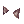 Wickebine's Black Cat Ears `5360` |  1000 Poring Coin `7539`  500 Black Cat Doll `7206` 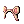 1 Kitty Band `2213` | Ears of Wickebine's black cat. Increases critical attack damage by 10%. Critical +3 FLEE +10 DEF -50%  **Class**: Headgear **Defense**: 2 **Position**: Upper **Weight**: 20 **Level Requirement**: 45 **Jobs**: All  |
|  Blush of Groom `5800` |  1500 Poring Coin `7539`  1 Blush `5040`  10 Rouge `739` | A blushing impression of a bridegroom. Reduces damage from DemiHuman monster by 3%.  **Class**: Headgear **Defense**: 0 **Position**: Middle **Weight**: 5 **Jobs**: All  |
| 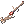 Antique Smoking Pipe `5377` |  1500 Poring Coin `7539` 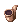 1 Pipe `2268` 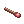 5 Matchstick `7035` | A long smoking pipe used by gentlemen and nobility. Decreases damage from Demi Human monster by 2%  **Class**: Headgear **Defense**: 0 **Position**: Lower **Weight**: 10 **Jobs**: All  |
|  Crimson Rose `5548` |  2000 Poring Coin `7539`  10 Rose Quartz `7293`  10 Illusion Flower `710` | A crimson colored rose. Be sure to check for thorns before putting this in your mouth. Luk +1 When killing a monster there is a chance of a Whitherless Rose dropping.  **Class**: Headgear **Defense**: 0 **Position**: Lower **Weight**: 10 **Level Requirement**: 50 **Jobs**: All  |
|  Vanilmirth Hat `5289` |  1000 Poring Coin `7539`  300 Large Jellopy `7126`  20 Flame Heart `994` | Indestructible. A cold, soft hat that is shaped like a Vanilmirth. Mdef +5 Randomly autocasts Level 1 Bolt magics when dealing physical attack.  **Class**: Headgear **Defense**: 0 **Position**: Upper **Weight**: 100 **Level Requirement**: 30 **Jobs**: All Unrefineable Undestructible  |
| 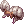 Gigantic Majestic Goat (DEF) `5374` |  1200 Poring Coin `7539` 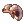 1 Majestic Goat [1] `5160`  1 Majestic Goat `2256` | A headgear made from the horns of Baphomet. Adds 12% tolerance against Demihuman monsters. Increases certain amount of ATK based on wearer's Job Level.  **Class**: Headgear **Defense**: 5 **Position**: Upper **Weight**: 80 **Level Requirement**: 50 **Jobs**: All  |
| 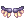 Filir's Pinions `5664` |  1500 Poring Coin `7539` 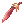 25 Red Feather `7440` 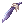 25 Blue Feather `7441` | A cute headgear made in the form of Filir's wings, the most popular bird-like homunclus. Increases attack speed by 2%. Improve Cast Speed 2%.  **Class**: Headgear **Defense**: 1 **Position**: Middle **Weight**: 10 **Level Requirement**: 70 **Jobs**: All  |
| 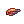 Pecopeco Wing Ears `5358` |  1000 Poring Coin `7539`  500 Peco Peco Feather `7101`  10 Illusion Flower `710` | An ornament wing created by Morgan Stanley's. Agi +1. Mdef +2.  **Class**: Headgear **Defense**: 1 **Position**: Middle **Weight**: 10 **Level Requirement**: 70 **Jobs**: All  |
| 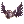 Darkness Helm [1] `5653` |  1500 Poring Coin `7539` 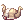 1 Bone Helm [1] `5162` 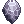 500 Crystal of Darkness `7799` | A helm crafted by Demons specially for the Dark Lord. Has several powers set to Dark Lords from the past generations. Hidden ability gets activated upon the combination of certain Mid Headgear. If equipped in combination with Evil Wing Ears, STR +1, ATK +5%. If equipped in combination with Angel Wing Ears, STR +1, ASPD +2%. If equipped in combination with Pecopeco Wing Ears, AGI +1, Flee +3. If equipped in combination with Black Frame Glasses, INT +1, MATK +2%.  **Class**: Headgear **Defense**: 3 **Position**: Upper **Weight**: 50 **Level Requirement**: 70 **Jobs**: All  |
| 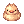 Chick Hat `5283` |  1200 Poring Coin `7539`  500 Feather of Birds `916` 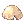 1 Egg Shell `5015` 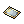 1 Sidewinder Card `4117` | A hat adorned with a cute chick that brings feelings of joy to those that see it hopping. Luk +2, MaxHP +50, MaxSP +50. Enable Level 2 Double Attack. Reduces damage taken from Demihuman and Brute monsters by 3%.  **Unrefineable** **Class**: Headgear **Defense**: 1 **Position**: Upper **Weight**: 10 **Level Requirement**: 10 **Jobs**: All  |
|  Rainbow Scarf `5463` |  1200 Poring Coin `7539`  500 Soft Silk `7166`  10 Red Feather `7440`  10 Blue Feather `7441` | A scarf with rainbow color. Matk +1%. Int +1. Mdef +2.  **Class**: Headgear **Defense**: 1 **Position**: Lower **Weight**: 10 **Level Requirement**: 90 **Jobs**: All  |
|  Skull Cap [1] `18539` |  3000 Poring Coin `7539`  200 Soft Feather `7063`  500 Skull `7005`  1 Black Dyestuffs `983` | A driver`s cap with a manacing skull on the band. Matk +2%. If refined to +5 or higher, adds an additional Matk +3%. If refined to +7 or higher, adds an additional Matk +3%. Special Effect: If equipped in combination with Elven Ears[0], decreases the SP cost of skill by 3%. If equipped in combination with Evil Bone Wand[0], each refine on the weapon adds Matk +1%. If the Evil Bone Wand[0] is refined to +10, reduces cast time of skill by 10%. If equipped in combination with Thorn Staff of Darkness[0], each refine on the weapon adds Matk +1%. If the Thorn Staff of Darkness (slotted or unslotted) is refined to +10 or higher, reduces cast time of skill by 10%.  **Class**: Headgear **Defense**: 0 **Position**: Upper **Weight**: 40 **Level Requirement**: 10 **Jobs**: All  |
| 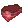 Gangster Scarf `5361` |  1200 Poring Coin `7539`  20 Scarlet Dyestuffs `975`  5 Gangster Mask `2265`  2 Pocket Watch `7513` | A gangster's red scarf. Atk +5 [Rogue class] Enable Level 1 Gangster Paradise.  **Class**: Headgear **Defense**: 0 **Position**: Lower **Weight**: 10 **Level Requirement**: 60 **Jobs**: All except Novice  |
| ![Devil's Bone Helm [1]](img/5529.png) Devil's Bone Helm [1] `5529` |  2000 Poring Coin `7539`  350 Clattering Skull `7752`  5 Ice Scale `7562`  350 Glacial Heart `7561` | Made from a frost giant's bones. No confirmation of its authenticity. Dex +3 Enable use of Level 1 Frost Nova. Reduce damage from Neutral elemental attacks by 5%.  **Class**: Headgear **Defense**: 6 **Position**: Upper, Middle **Weight**: 60 **Level Requirement**: 1 **Jobs**: All  |
| 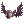 Dark Randgris Helm [1] `5373` |  2000 Poring Coin `7539`  50 Valhalla's Flower `7510` 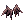 1 Evil Wing Ears `5068`  1 Angel Wing Ears `5074` | Helm imbued with Valkyrie Randgris' power. Dex +3, Mdef +1  **Class**: Headgear **Defense**: 2 **Position**: Upper, Middle **Weight**: 30 **Jobs**: All  |
| ![Large Orc Hero Helm [1]](img/5375.png) Large Orc Hero Helm [1] `5375` |  4000 Poring Coin `7539`  100 Heroic Emblem `968`  20 Gold `969` | An Orc Hero's massive headgear. Str +2 Adds 3% chance to autocast Level 3 Weapon Perfection when receiving physical damage.  **Class**: Headgear **Defense**: 5 **Position**: Upper, Middle **Weight**: 90 **Jobs**: All  |
| 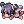 Little Angel Doll `5324` |  2000 Poring Coin `7539`  50 Red Feather `7440` 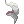 50 Fur `6020` | Angelic protector that summons holy wrath on attackers. Dex +3 Chance to cast Level 3 Grand Cross when hit by melee physical attack.  **Class**: Headgear **Defense**: 2 **Position**: Upper **Weight**: 30 **Level Requirement**: 10 **Jobs**: All  |
| 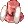 Bunny Ears Hat `5378` |  1200 Poring Coin `7539`  1 Magician Hat `5045`  350 Wing of Dragonfly `7064`  1 Spring Rabbit Card `4227` | A cute red top hat with bunny ears. Perfect for a magic show! Agi +3 Chance to cast Level 5 Increase Agi when user receives physical damage.  **Class**: Headgear **Defense**: 0 **Position**: Upper **Weight**: 30 **Jobs**: All  |
|  Well-Chewed Pencil `5574` |  700 Poring Coin `7539`  7 Pencil Case `738`  1 Apple of Archer `2285` 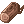 450 Wooden Gnarl `7222` | A popular test snack, but probably best not left in your mouth for long. Hit +3 When equipped with 'Model Training Hat', Dex +2, DEF +2.  **Class**: Headgear **Defense**: 0 **Position**: Lower **Weight**: 10 **Level Requirement**: 10 **Jobs**: All  |
|  Fish in Mouth `5403` |  700 Poring Coin `7539`  350 Ancient Lips `1054`  50 Mystic Frozen `995`  50 Rough Wind `996` | A fish that won't rot in your mouth. Killing monsters grants a chance to drop Fresh Fish. Increases Fresh Fish recovery rate by 25%.  **Class**: Headgear **Defense**: 0 **Position**: Lower **Weight**: 20 **Level Requirement**: 30 **Jobs**: All  |
|  Alice Doll [1] `5137` |  2000 Poring Coin `7539`  500 Alice's Apron `7047`  3 Soft Apron `661`  1 Marionette Doll [1] `5141`  1 Hydra Card `4035` | A doll modeled after Alice, providing cheer from atop your head. Str +1 Increases damage to Demihumans by 10%. Inflicts Sleep status when attacking.  **Class**: Headgear **Defense**: 0 **Position**: Upper **Weight**: 50 **Level Requirement**: 30 **Jobs**: All except Novice  |
| 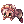 Glaris Doll Hat [1] `5341` |  2000 Poring Coin `7539`  500 Alice's Apron `7047`  3 Soft Apron `661`  1 Marionette Doll [1] `5141`  1 Thara Frog Card `4058` | Headgear inspired by Kafra Glaris, known for her teacher-like authority. Decreases damage from Demihumans by 5%. Recover 50 HP when killing a monster with a magical attack.  **Class**: Headgear **Defense**: 0 **Position**: Upper **Weight**: 50 **Level Requirement**: 60 **Jobs**: All  |
|  Defolty Doll Hat [1] `5340` |  2000 Poring Coin `7539`  500 Alice's Apron `7047`  3 Soft Apron `661`  1 Marionette Doll [1] `5141`  1 Thara Frog Card `4058` | So hot! A headgear with the figure of Kafra Defolty! Numerous users are using Kafra storage more than 20 times a day, fascinated by her smiling face. Decreases 5% damage from Demihuman monsters. Autocasts Level 10 Angelus when physically attacked within short range.  **Class**: Headgear **Defense**: 0 **Position**: Upper **Weight**: 50 **Level Requirement**: 60 **Jobs**: All  |
| ![Carmen Miranda's Hat [1]](img/5307.png) Carmen Miranda's Hat [1] `5307` |  2000 Poring Coin `7539`  250 Red Prickly Fruit `587` 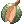 250 Prickly Fruit `576` | A hat made with tropical fruits. It looks delicious. Mdef +3 Auto casts Charming Wink with low chance when attacked.  **Class**: Headgear **Defense**: 3 **Position**: Upper **Weight**: 40 **Jobs**: All  |
| 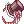 Dress Hat [1] `5211` |  2000 Poring Coin `7539`  1 Magician Hat `5045`  500 Soft Feather `7063` | A tiny and cute hat that can decorate a part of the head. This hat, along with a pretty dress, makes the wearer want to go on a picnic. Str +1, Int +1 Atk +2%, Matk +2% Mdef +7 Increases Healing skills by 5%. Refine Level +7: Atk +1%, Matk +1% Increases Healing skills by 1%.  **Class**: Headgear **Defense**: 2 **Position**: Upper **Weight**: 20 **Level Requirement**: 20 **Jobs**: All  |
|  Rideword Hat [1] `5208` |  2000 Poring Coin `7539` 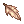 200 Bookclip in Memory `7015`  2 Old Magic Book `1006` | A hat designed to mimic the look of a terrible magic book which attacks people. Randomly absorbs 8% physical damage inflicted into HP. Randomly absorbs 4% physical damage inflicted into SP. Drains 10 HP every 5 seconds while equipped.  **Class**: Headgear **Defense**: 2 **Position**: Upper **Weight**: 30 **Level Requirement**: 40 **Jobs**: All  |
|  Festival Pumpkin Hat `5356` |  1200 Poring Coin `7539`  1000 Pumpkin Lantern `7225`  20 Four Leaf Clover `706` | A pumpkin hat for celebrating Halloween: wear it when you go trick-or-theating! All stats +3. Increase Physical and Magical Attack Strength against Demon monsters by 5%.  **Class**: Headgear **Defense**: 3 **Position**: Upper **Weight**: 20 **Jobs**: All  |
|  Pirate Dagger `5305` |  1200 Poring Coin `7539`  20 Well-Dried Bone `628`  120 Wooden Heart `7189` | A small sivler knife that is held between your teeth to allow free use of your hands. Atk +5.  **Class**: Headgear **Defense**: 0 **Position**: Lower **Weight**: 10 **Jobs**: All  |
| 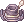 Purple Cowboy Hat [1] `5409` |  1200 Poring Coin `7539` 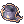 1 Corsair `5019`  300 Soft Feather `7063` | A hat, symbolizing western frontiers, made to celebrate, the festival. Int +2, Vit +2, MaxSP +50.  **Class**: Headgear **Defense**: 4 **Position**: Upper **Weight**: 50 **Jobs**: All  |
|  Santa Poring Hat [1] `5381` |  1200 Poring Coin `7539`  10 Santa Hat `2236` 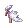 1 Angel Wing `2254` 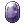 20 Turquoise `7294` | A cute hat made from a hopping Poring wearing a Santa's Hat. Increases physical damage inflicted on Shadow elemental monsters by 3%. Reduces damage taken from Shadow elemental attack by 3%. +2 MDEF, Cannot be refined.  **Class**: Headgear **Defense**: 2 **Position**: Upper **Weight**: 10 **Jobs**: All  |
|  Necromancer's Hood `5502` |  1200 Poring Coin `7539` 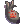 10 Cursed Seal `7442`  50 Evil Horn `923` | The Deadly Necromancer's Essence is embodied in this Hood. Add a 5% chance of auto casting Level 5 Dark Strike when player receives Physical Damage.  **Class**: Headgear **Defense**: 2 **Position**: Upper, Middle **Weight**: 10 **Level Requirement**: 10 **Jobs**: All  |
|  Koneko Hat `5372` |  1200 Poring Coin `7539` 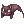 1 Drooping Cat `5058` | A magical kitty hat which shows various expressions on its face. Reduces Cast Delay of all skills by 3%. Matk +3%, MaxSP +3%. Mdef +3, Int +1.  **Class**: Headgear **Defense**: 1 **Position**: Upper **Weight**: 50 **Jobs**: All  |
|  Moonlight Flower Hat `5214` |  1200 Poring Coin `7539`  500 Nine Tails `1022`  250 Topaz `728` | A hat inspired by the adorable Moonlight Flower. Be sure to hand-wash to prolong the soft Nine Tail Fur lining. Dex +2. Randomly autocasts Level 1 Increase Agility when dealing physical attack.  **Class**: Headgear **Defense**: 3 **Position**: Upper, Middle **Weight**: 20 **Jobs**: All  |
| 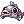 Fish Head hat `5380` |  700 Poring Coin `7539`  300 Fresh Fish `579` | A gaping fish head fashioned into a hat. A nasty stench is released whenever it opens its mouth. Adds a low chance of automatically casting Level 1 Frost Weapon with each physical attack.  **Class**: Headgear **Defense**: 1 **Position**: Upper **Weight**: 40 **Jobs**: All  |

