# Endless Cellar

A team-based instance where a party fights through 77 floors of monsters, mini-bosses and MVPs, with a Bio Laboratory MVP gauntlet and Pori Pori on the last floor.

!!! info "Quick Facts"
    - **Location:** Captain Janssen in Prontera (`/navi prontera 217/187`), then Misty Island
    - **Party Size:** 6 person minimum
    - **Base Level:** 85
    - **Time Limit:** 4 hours
    --8<-- "instances.md:fact-endless-cellar"

## Rules

| Rule | Detail |
|------|--------|
| **Death** | Normal: players can be resurrected and come back into the instance. |
--8<-- "instances.md:rule-reentry"
--8<-- "instances.md:rule-storage"
--8<-- "instances.md:rule-rodex"
| **Loot** | Drops as normal, with [some modifications](#loot-changes). |
--8<-- "instances.md:rule-unlock-endless-cellar"
| **Monster Count** | Monsters remaining per floor are announced starting with 5 remaining. |

## Getting There

--8<-- "captain-janssen.md"

--8<-- "misty-island.md"

On Misty Island, locate the **Cellar Protection Stone** NPC and select **Enter Endless Cellar**. All party members must be present on Misty Island when the Party Leader clicks the stone to start the dungeon.

{ .wiki-screenshot }

{ .wiki-screenshot }

--8<-- "instances.md:ready-rule"

## Rewards

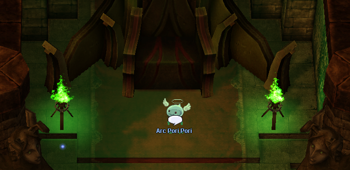{ .wiki-screenshot }

After defeating Pori Pori, **Arc Pori Pori** appears and gives each party member a completion reward:

| Name | Amount |
|------|--------|
|  Old Card Album | 1 |
| 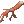 Bloody Branch | 1 |
|  Jewelry Box | 1 |
|  Poring Box | 1 |
| 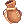 Cookie Bag | 1 |

!!! warning "Claim Your Reward"
    Talk to **Arc Pori Pori** before returning to Prontera. Exiting through him is required to unlock your next weekly run.

## Monsters

Each floor lists its monsters with how many spawn.

### 1-24

| Floor 1 | Floor 2 | Floor 3 | Floor 4 |
|:---------|:---------|:---------|:---------|
|  20 Fabre (`1007`{ .copy })   10 Picky (`1049`{ .copy })  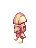 10 Picky (`1050`{ .copy }) | 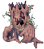 10 Willow (`1010`{ .copy })  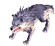 10 Wolf (`1013`{ .copy })  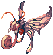 10 Creamy (`1018`{ .copy }) | .gif) 10 Condor (`1009`{ .copy })  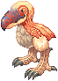 10 Peco Peco (`1019`{ .copy })  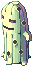 10 Muka (`1055`{ .copy })  | 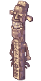 25 Greatest General (`1277`{ .copy })   1 Eddga (`1115`{ .copy })
| **Floor 5** | **Floor 6** | **Floor 7** | **Floor 8** |
|  15 Spore (`1014`{ .copy })  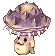 15 Poison Spore (`1077`{ .copy })  | 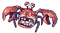 15 Crab (`1073`{ .copy })  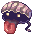 15 Shellfish (`1074`{ .copy })   15 Aster (`1266`{ .copy }) | .gif) 10 Vadon (`1066`{ .copy })  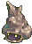 10 Cornutus (`1067`{ .copy })   10 Marina (`1141`{ .copy })  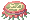 10 Plankton (`1161`{ .copy }) |  10 Garm Baby (`1515`{ .copy })   20 Marine Sphere (`1142`{ .copy })  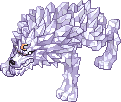 1 Garm (`1252`{ .copy }) |
| **Floor 9** | **Floor 10** | **Floor 11** | **Floor 12** |
| 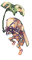 20 Metaller (`1058`{ .copy })   20 Magnolia (`1138`{ .copy }) | 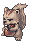 15 Coco (`1104`{ .copy })  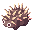 15 Caramel (`1103`{ .copy })  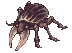 15 Horn (`1128`{ .copy }) |  25 Orc Warrior (`1023`{ .copy })   25 Eggyra (`1116`{ .copy }) | 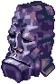 10 Megalith (`1274`{ .copy })   10 Panzer Goblin (`1308`{ .copy })  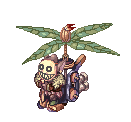 10 Rotar Zairo (`1392`{ .copy })   10 Steam Goblin (`1280`{ .copy })   1 Tao Gunka (`1583`{ .copy }) |
| **Floor 13** | **Floor 14** | **Floor 15** | **Floor 16** |
| 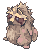 15 Smokie (`1056`{ .copy })   15 Giearth (`1121`{ .copy })   15 Martin (`1145`{ .copy })   15 Raggler (`1254`{ .copy }) |  25 Wormtail (`1024`{ .copy })   25 Stem Worm (`1215`{ .copy }) |  10 Christmas Jakk (`1244`{ .copy })   10 Christmas Goblin (`1245`{ .copy })   10 Christmas Cookie (`1246`{ .copy })  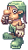 10 Cookie (`1265`{ .copy })   10 Christmas Orc (`1588`{ .copy }) |  25 Antonio (`1247`{ .copy })   25 Santa Poring (`1062`{ .copy })  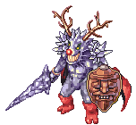 1 Knight of Windstorm (`1251`{ .copy }) |
| **Floor 17** | **Floor 18** | **Floor 19** | **Floor 20** |
|  10 Roda Frog (`1012`{ .copy })   10 Thara Frog (`1034`{ .copy })   10 Poison Toad (`1402`{ .copy })   1 Toad (`1089`{ .copy }) |  20 Lunatic (`1063`{ .copy })  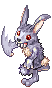 20 Spring Rabbit (`1322`{ .copy })   1 Eclipse (`1093`{ .copy }) | 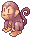 20 Yoyo (`1057`{ .copy })   20 Mime Monkey (`1585`{ .copy })  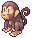 1 Choco (`1214`{ .copy }) | 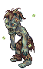 10 Ghoul (`1036`{ .copy })  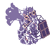 10 Myst (`1151`{ .copy })  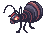 10 Vitata (`1176`{ .copy })   10 Zenorc (`1177`{ .copy })  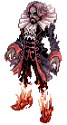 1 Dracula (`1389`{ .copy }) |
| **Floor 21** | **Floor 22** | **Floor 23** | **Floor 24** |
| 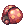 30 Stainer (`1174`{ .copy })   20 Brilight (`1211`{ .copy }) | 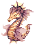 15 Marc (`1045`{ .copy })   15 Tri Joint (`1279`{ .copy })   15 Fur Seal (`1317`{ .copy })   15 Sea Otter (`1323`{ .copy }) | 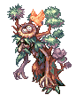 20 Wood Goblin (`1880`{ .copy })  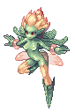 20 Les (`1881`{ .copy })   10 Mavka (`1884`{ .copy }) | 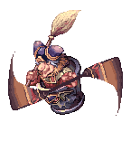 20 Baba Yaga (`1882`{ .copy })   10 Uzhas (`1883`{ .copy })  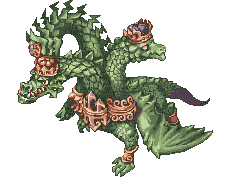 1 Gopinich (`1885`{ .copy }) |

### 25-52

| Floor 25 | Floor 26 | Floor 27 | Floor 28 |
|----------|----------|----------|----------|
|  15 Kaho (`1072`{ .copy })  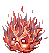 15 Blazer (`1367`{ .copy })  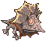 15 Driller (`1380`{ .copy })   10 Horong (`1129`{ .copy })  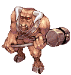 5 Minorous (`1149`{ .copy }) |  30 Dokebi (`1110`{ .copy })   20 Am Mut (`1301`{ .copy })  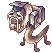 10 Sage Worm (`1281`{ .copy }) |  30 Savage (`1166`{ .copy })  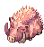 20 Gullinbursti (`1311`{ .copy })  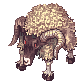 10 Goat (`1372`{ .copy }) | 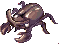 20 Beetle King (`1494`{ .copy })   10 Bacsojin (`1518`{ .copy })   10 Chung E (`1519`{ .copy })  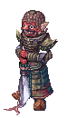 30 Tamruan (`1584`{ .copy })  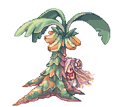 1 Lady Tanee (`1688`{ .copy }) |
| **Floor 29** | **Floor 30** | **Floor 31** | **Floor 32** |
|  25 Requiem (`1164`{ .copy })  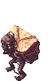 25 Zerom (`1178`{ .copy })  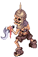 10 Skeleton General (`1290`{ .copy }) |  25 Leaf Cat (`1586`{ .copy })  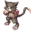 25 Wild Rose (`1261`{ .copy }) |  10 Dustiness (`1114`{ .copy })   10 Giant Spider (`1304`{ .copy })   10 Porcellio (`1619`{ .copy })   10 Pitman (`1616`{ .copy }) |  10 Mineral (`1614`{ .copy })   10 Waste Stove (`1617`{ .copy })   10 Noxious (`1620`{ .copy })   10 Venomous (`1621`{ .copy })   10 Teddy Bear (`1622`{ .copy })   1 RSX 0806 (`1623`{ .copy }) |
| **Floor 33** | **Floor 34** | **Floor 35** | **Floor 36** |
|  15 Bathory (`1102`{ .copy })   15 Sohee (`1170`{ .copy })   15 Violy (`1390`{ .copy }) |  15 Dragon Tail (`1321`{ .copy })   15 Geographer (`1368`{ .copy })   15 Galapago (`1391`{ .copy })   15 Kapha (`1406`{ .copy }) |  15 Rice Cake Boy (`1409`{ .copy })   15 Boiled Rice (`1520`{ .copy })   15 Baby Leopard (`1415`{ .copy }) |  30 Disguise (`1506`{ .copy })   20 Dark Priest (`1198`{ .copy })   1 Lord of Death (`1373`{ .copy }) |
| **Floor 37** | **Floor 38** | **Floor 39** | **Floor 40** |
|  25 Wootan Shooter (`1498`{ .copy })   25 Wootan Fighter (`1499`{ .copy }) |  30 Mole (`1628`{ .copy })   10 Maya Purple (`1289`{ .copy }) |  10 Safeguard Chief (`1981`{ .copy })   10 Orc Sniper (`1982`{ .copy })   10 Depraved Orc Spirit (`1983`{ .copy })   10 Shaman Cargalache (`1984`{ .copy }) |  15 Magmaring (`1836`{ .copy })   15 Knocker (`1838`{ .copy })   15 Imp (`1837`{ .copy }) |
| **Floor 41** | **Floor 42** | **Floor 43** | **Floor 44** |
|  25 Removal (`1682`{ .copy })   25 Gemini-S58 (`1681`{ .copy }) |  25 Breeze (`1692`{ .copy })   25 Roween (`1782`{ .copy }) |  25 Gremlin (`1632`{ .copy })   25 Hodremlin (`1773`{ .copy }) |  25 Novus (`1715`{ .copy })   25 Acidus (`1716`{ .copy })   1 Detale (`1719`{ .copy }) |
| **Floor 45** | **Floor 46** | **Floor 47** | **Floor 48** |
|  25 Banshee Master (`1974`{ .copy })   25 Banshee (`1868`{ .copy }) |  25 Beholder Master (`1975`{ .copy })   15 Beholder (`1633`{ .copy })   15 Seeker (`1774`{ .copy }) |  25 Cobalt Mineral (`1976`{ .copy })   25 Heavy Metaling (`1977`{ .copy }) |  30 Alicel (`1735`{ .copy })   30 Constant (`1738`{ .copy })   1 Kiel D-01 (`1734`{ .copy }) |
| **Floor 49** | **Floor 50** | **Floor 51** | **Floor 52** |
|  50 Frus (`1753`{ .copy }) |  25 Hell Apocalips (`1978`{ .copy })   25 Apocalypse (`1365`{ .copy }) |  25 Zukadam (`1979`{ .copy })   25 Archdam (`1668`{ .copy }) |  25 Aunoe (`1796`{ .copy })   25 Fanat (`1797`{ .copy })   1 Gloom Under Night (`1768`{ .copy }) |

### 53-76

| Floor 53 | Floor 54 | Floor 55 | Floor 56 |
|----------|----------|----------|----------|
|  25 Zombie Slaughter (`1864`{ .copy })   25 Hell Poodle (`1866`{ .copy }) |  30 Siroma (`1776`{ .copy })   20 Snowier (`1775`{ .copy })   10 Ice Titan (`1777`{ .copy }) |  75 Iceicle (`1789`{ .copy }) |  30 Gazeti (`1778`{ .copy })   1 Ktullanux (`1779`{ .copy }) |
| **Floor 57** | **Floor 58** | **Floor 59** | **Floor 60** |
|  10 Photon Cannon (`1664`{ .copy })   10 Photon Cannon (`1665`{ .copy })   10 Photon Cannon (`1666`{ .copy })   10 Photon Cannon (`1667`{ .copy })   1 Vesper (`1685`{ .copy }) |  3 Ghostring (`1120`{ .copy })   3 Angeling (`1096`{ .copy })   3 Deviling (`1582`{ .copy })   3 Archangeling (`1388`{ .copy })   3 Mastering (`1090`{ .copy }) |  12 Thanatos Odium (`1704`{ .copy })   12 Thanatos Despero (`1705`{ .copy })   12 Thanatos Maero (`1706`{ .copy })   12 Thanatos Dolor (`1707`{ .copy }) |  1 Thanatos (`1708`{ .copy }) |
| **Floor 61** | **Floor 62** | **Floor 63** | **Floor 64** |
|  40 Pinguicula (`1995`{ .copy })   40 Dark Pinguicula (`2015`{ .copy }) |  60 Nepenthes (`1988`{ .copy })   30 Luciola Vespa (`1994`{ .copy }) |  50 Naga (`1993`{ .copy })   20 Cornus (`1992`{ .copy }) |  15 Hillslion (`1989`{ .copy })   2 Tendrillion (`1991`{ .copy }) |
| **Floor 65** | **Floor 66** | **Floor 67** | **Floor 68** |
|  50 Centipede Larva (`1999`{ .copy })   25 Centipede (`1987`{ .copy }) |  30 Draco Egg (`2014`{ .copy })   10 Draco (`2013`{ .copy })   40 Tatacho (`1986`{ .copy }) |  30 Bradium Golem (`2024`{ .copy })   10 Stalactic Golem (`1278`{ .copy })   20 Lava Golem (`1366`{ .copy }) |  10 Tatacho (`1986`{ .copy })   2 Hardrock Mammoth (`1990`{ .copy }) |
| **Floor 69** | **Floor 70** | **Floor 71** | **Floor 72** |
|  25 Aqua Elemental (`2016`{ .copy })   25 Rhyncho (`2020`{ .copy })   25 Phylla (`2021`{ .copy }) |  35 Ancient Tree (`2019`{ .copy })   15 Dark Shadow (`2023`{ .copy }) |  12 Rata (`2017`{ .copy })   12 Duneyrr (`2018`{ .copy }) |  1 Nidhoggr's Shadow (`2022`{ .copy }) |
| **Floor 73** | **Floor 74** | **Floor 75** | **Floor 76** |
|  16 Byorgue (`1839`{ .copy }) |  2 Lord Knight Seyren (`1640`{ .copy })   2 Assassin Cross Eremes (`1641`{ .copy })   2 Whitesmith Harword (`1642`{ .copy })   2 High Priest Magaleta (`1643`{ .copy })   2 Sniper Shecil (`1644`{ .copy })   2 High Wizard Katrinn (`1645`{ .copy }) |  7 Incarnation of Morroc (`1918`{ .copy })   7 Incarnation of Morroc (`1919`{ .copy })   7 Incarnation of Morroc (`1920`{ .copy })   7 Incarnation of Morroc (`1921`{ .copy }) |  1 Wounded Morroc (`1917`{ .copy }) |

Wounded Morroc has a reduced drop rate here, to keep competition for top-tier gear on the server.
{ #loot-changes }

### 77 (Final Floor)

| Stage 1 | Stage 2 | Stage 3 | Stage 4 |
|---------|---------|---------|---------|
|  1 Poring (`1002`{ .copy }) | Two random MVPs from **Bio Laboratory F3** |  1 Super Baphomet (`1399`{ .copy })   2 Piamette (`1930`{ .copy })   2 Wish Maiden (`1931`{ .copy }) |  1 Pori Pori (`1502`{ .copy })   10 Golden Savage (`1840`{ .copy })   10 Pouring (`1894`{ .copy })   20 Bomb Poring (`1904`{ .copy }) |

Only the two random Bio Laboratory F3 MVPs spawn with the full drop rate; the rest are reduced.
