# Endless Tower

A team-based instance where a party climbs the tower floor by floor, clearing every monster on a floor to open the way up. Naght Sieger waits at the very top.

!!! info "Quick Facts"
    - **Location:** Captain Janssen in Prontera (`/navi prontera 217/187`), then Misty Island
    - **Party Size:** 6 person minimum
    - **Base Level:** 85
    - **Time Limit:** 4 hours
    --8<-- "instances.md:fact-endless-tower"

## Rules

| Rule | Detail |
|------|--------|
| **Death** | Normal: players can be resurrected and come back into the instance. |
--8<-- "instances.md:rule-reentry"
--8<-- "instances.md:rule-storage"
--8<-- "instances.md:rule-rodex"
| **Loot** | Drops as normal. |
--8<-- "instances.md:rule-unlock-endless-tower"
| **Party Follow** | Original members who leave and re-enter can rejoin the party's current floor without climbing back up, which makes restocking quick. |
| **Level Skip** | Not available. |
| **Clearing a Floor** | Every monster on a floor must be defeated before the gate to the next floor opens. Taming a monster doesn't count as defeating it. |

## Getting There

--8<-- "captain-janssen.md"

--8<-- "misty-island.md"

On Misty Island, locate the **Tower Protection Stone** NPC and select **Enter Endless Tower**. All party members must be present on Misty Island when the Party Leader clicks the stone to start the dungeon.

--8<-- "instances.md:ready-rule"

## Rewards

After Naght Sieger falls, speak to the **Lost Soul** to exit; this is what unlocks your next weekly run.

If you carry both **Twin Edge of Naght Sieger** swords (`13412`{ .copy } and `13413`{ .copy }), the Lost Soul combines them into a **Violet Fear** (`1185`{ .copy }) two-handed sword. Any refine or card on the originals is lost in the process.

## Monsters

Each floor lists its monsters with how many spawn.

### 1-25

| Floor 1 | Floor 2 | Floor 3 | Floor 4 |
|---------|---------|---------|---------|
|  15 Metaling (`1613`{ .copy })   5 Marin (`1242`{ .copy })   5 Poporing (`1031`{ .copy })   5 Drops (`1113`{ .copy })   1 Mastering (`1090`{ .copy })   5 Poring (`1002`{ .copy }) | 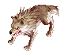 20 Desert Wolf (`1106`{ .copy })  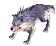 1 Vagabond Wolf (`1092`{ .copy })  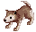 10 Desert Wolf Baby (`1107`{ .copy }) | 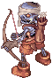 5 Archer Skeleton (`1016`{ .copy })  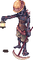 5 Skeleton Worker (`1169`{ .copy })  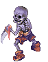 5 Soldier Skeleton (`1028`{ .copy })  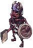 5 Orc Skeleton (`1152`{ .copy })  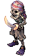 5 Pirate Skeleton (`1071`{ .copy })   5 Skeleton (`1076`{ .copy }) | 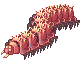 15 Argiope (`1099`{ .copy })  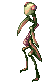 5 Mantis (`1139`{ .copy })  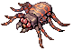 5 Argos (`1100`{ .copy })  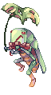 1 Vocal (`1088`{ .copy })  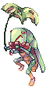 5 Rocker (`1052`{ .copy })  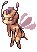 5 Hornet (`1004`{ .copy }) |
| **Floor 5** | **Floor 6** | **Floor 7** | **Floor 8** |
| 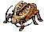 1 Golden Thief Bug (`1086`{ .copy })  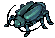 15 Thief Bug Male (`1054`{ .copy })  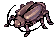 15 Thief Bug Female (`1053`{ .copy })   15 Thief Bug (`1051`{ .copy })  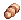 5 Thief Bug Egg (`1048`{ .copy }) |  5 Dragon Egg (`1721`{ .copy })   5 Thief Bug Egg (`1048`{ .copy })   5 Ant Egg (`1097`{ .copy })  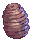 5 Pupa (`1008`{ .copy }) | 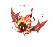 15 Explosion (`1383`{ .copy })  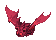 15 Drainliar (`1111`{ .copy })   15 Anopheles (`1627`{ .copy })  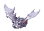 15 Familiar (`1005`{ .copy }) | 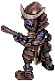 15 Antique Firelock (`1403`{ .copy })  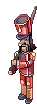 15 Cruiser (`1248`{ .copy }) |
| **Floor 9** | **Floor 10** | **Floor 11** | **Floor 12** |
| 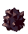 15 Obsidian (`1615`{ .copy })  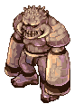 15 Golem (`1040`{ .copy })  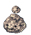 10 Stapo (`1784`{ .copy }) | 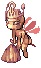 1 Mistress (`1059`{ .copy })  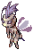 25 Giant Hornet (`1303`{ .copy })   20 Hornet (`1004`{ .copy }) | 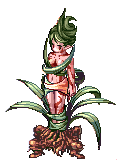 15 Dryad (`1493`{ .copy })   15 Parasite (`1500`{ .copy })   15 Wild Ginseng (`1413`{ .copy })  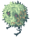 5 Rafflesia (`1162`{ .copy }) | 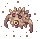 25 Demon Pungus (`1378`{ .copy })  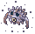 25 Punk (`1199`{ .copy }) |
| **Floor 13** | **Floor 14** | **Floor 15** | **Floor 16** |
| 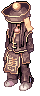 15 Hyegun (`1512`{ .copy })  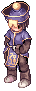 15 Bongun (`1188`{ .copy })   10 Munak (`1026`{ .copy }) | 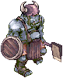 15 High Orc (`1213`{ .copy })  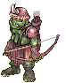 10 Orc Archer (`1189`{ .copy })  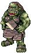 10 Orc Lady (`1273`{ .copy })  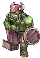 5 Orc Warrior (`1023`{ .copy })  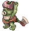 5 Orc Baby (`1686`{ .copy }) | 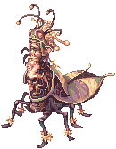 1 Maya (`1147`{ .copy })   1 Phreeoni (`1159`{ .copy })  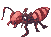 15 Deniro (`1105`{ .copy })  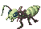 15 Piere (`1160`{ .copy })  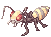 15 Andre (`1095`{ .copy })   5 Ant Egg (`1097`{ .copy }) | 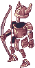 10 Raydric Archer (`1276`{ .copy })   10 Orc Archer (`1189`{ .copy })  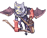 10 Gargoyle (`1253`{ .copy })   10 Archer Skeleton (`1016`{ .copy }) |
| **Floor 17** | **Floor 18** | **Floor 19** | **Floor 20** |
| 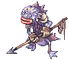 10 Merman (`1264`{ .copy })  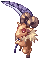 10 Baphomet Jr. (`1101`{ .copy })  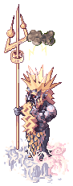 15 Strouf (`1065`{ .copy })  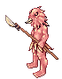 5 Hill Wind (`1629`{ .copy }) |  25 Cramp (`1209`{ .copy })   15 Tarou (`1175`{ .copy }) |  10 Deviace (`1108`{ .copy })   10 Megalodon (`1064`{ .copy })   10 Swordfish (`1069`{ .copy })   10 Phen (`1158`{ .copy }) |  1 Drake (`1112`{ .copy })   50 Pirate Skeleton (`1071`{ .copy }) |
| **Floor 21** | **Floor 22** | **Floor 23** | **Floor 24** |
|  10 Plasma (`1693`{ .copy })   10 Plasma (`1696`{ .copy })   5 Plasma (`1695`{ .copy })   5 Plasma (`1697`{ .copy })   5 Plasma (`1694`{ .copy }) |  15 Muscipular (`1780`{ .copy })   15 Drosera (`1781`{ .copy })   15 Flora (`1118`{ .copy })   15 Hydra (`1068`{ .copy })   10 Mandragora (`1020`{ .copy })   10 Rafflesia (`1162`{ .copy }) |  15 Penomena (`1216`{ .copy })   10 Obeaune (`1044`{ .copy })   10 Marse (`1144`{ .copy })   10 Swordfish (`1069`{ .copy })   5 Hydra (`1068`{ .copy }) |  15 Joker (`1131`{ .copy })   15 Carat (`1267`{ .copy })   10 Jakk (`1130`{ .copy }) |
| **Floor 25** |
|  15 Cat o' Nine Tails (`1307`{ .copy })   1 Moonlight Flower (`1150`{ .copy })   15 Nine Tail (`1180`{ .copy }) |

### 26-50

| Floor 26 | Floor 27 | Floor 28 | Floor 29 |
|---------|---------|---------|---------|
|  10 Gibbet (`1503`{ .copy })   10 Live Peach Tree (`1410`{ .copy })   10 Wooden Golem (`1497`{ .copy })   10 Stone Shooter (`1495`{ .copy })   5 Elder Willow (`1033`{ .copy }) |  10 Goblin Archer (`1258`{ .copy })   10 Goblin (`1122`{ .copy })   5 Goblin (`1123`{ .copy })   5 Goblin (`1124`{ .copy })   5 Goblin (`1125`{ .copy })   5 Goblin (`1126`{ .copy }) |  30 Arclouse (`1194`{ .copy })   15 Neraid (`1255`{ .copy })   15 Pest (`1256`{ .copy })   10 Kukre (`1070`{ .copy }) |  10 Dark Frame (`1260`{ .copy })   10 The Paper (`1375`{ .copy })   10 Hylozoist (`1510`{ .copy })   5 Quve (`1508`{ .copy })   5 Lude (`1509`{ .copy })   10 Whisper (`1179`{ .copy }) |
| **Floor 30** | **Floor 31** | **Floor 32** | **Floor 33** |
|  1 Bacsojin (`1630`{ .copy })   30 Wicked Nymph (`1416`{ .copy }) |  20 Gig (`1387`{ .copy })   15 Iron Fist (`1212`{ .copy })   10 Argiope (`1099`{ .copy })   5 Scorpion (`1001`{ .copy }) |  1 Goblin Leader (`1299`{ .copy })   10 Goblin Archer (`1258`{ .copy })   10 Goblin (`1122`{ .copy })   5 Goblin (`1123`{ .copy })   5 Goblin (`1124`{ .copy })   5 Goblin (`1125`{ .copy })   5 Goblin (`1126`{ .copy }) |  1 Kobold Leader (`1296`{ .copy })   15 Kobold (`1133`{ .copy })   15 Kobold Archer (`1282`{ .copy })   10 Kobold (`1134`{ .copy })   5 Kobold (`1135`{ .copy }) |
| **Floor 34** | **Floor 35** | **Floor 36** | **Floor 37** |
|  20 Flame Skull (`1869`{ .copy })   10 Whisper (`1179`{ .copy })   10 Giant Whisper (`1186`{ .copy }) |  1 Turtle General (`1312`{ .copy })   10 Freezer (`1319`{ .copy })   10 Solider (`1316`{ .copy })   10 Heater (`1318`{ .copy })   10 Permeter (`1314`{ .copy }) |  30 Anolian (`1206`{ .copy })   10 Green Iguana (`1687`{ .copy })   10 Alligator (`1271`{ .copy }) |  10 Clock Tower Manager (`1270`{ .copy })   10 Clock (`1269`{ .copy })   30 Alarm (`1193`{ .copy }) |
| **Floor 38** | **Floor 39** | **Floor 40** | **Floor 41** |
|  25 Deathword (`1698`{ .copy })   25 Rideword (`1195`{ .copy }) |  10 Wicked Nymph (`1416`{ .copy })   10 Civil Servant (`1513`{ .copy })   10 Evil Cloud Hermit (`1412`{ .copy })   10 Dancing Dragon (`1514`{ .copy })   5 Li Me Mang Ryang (`1517`{ .copy }) |  1 Incantation Samurai (`1492`{ .copy })   10 Shinobi (`1401`{ .copy })   10 Tengu (`1405`{ .copy })   5 Antique Firelock (`1403`{ .copy })   10 Miyabi Ningyo (`1404`{ .copy })   5 Karakasa (`1400`{ .copy }) |  50 Kraben (`1587`{ .copy }) |
| **Floor 42** | **Floor 43** | **Floor 44** | **Floor 45** |
|  20 Sleeper (`1386`{ .copy })   10 Sting (`1207`{ .copy })   10 Increase Soil (`1516`{ .copy })   5 Sandman (`1165`{ .copy })   5 Hode (`1127`{ .copy }) |  10 Medusa (`1148`{ .copy })   40 Side Winder (`1037`{ .copy })   5 Anacondaq (`1030`{ .copy })   5 Snake (`1025`{ .copy }) |  20 Garm Baby (`1515`{ .copy })   20 Baphomet Jr. (`1101`{ .copy })   1 Orc Baby (`1686`{ .copy })   10 Desert Wolf Baby (`1107`{ .copy })   10 Savage Babe (`1167`{ .copy }) |  1 Osiris (`1038`{ .copy })   15 Ancient Mummy (`1297`{ .copy })   15 Verit (`1032`{ .copy })   20 Mummy (`1041`{ .copy }) |
| **Floor 46** | **Floor 47** | **Floor 48** | **Floor 49** |
|  20 Seeker (`1774`{ .copy })   20 Beholder (`1633`{ .copy }) |  20 Deleter (`1384`{ .copy })   10 Deleter (`1385`{ .copy })   10 Petite (`1156`{ .copy })   10 Petite (`1155`{ .copy }) |  10 Ancient Worm (`1305`{ .copy })   10 Ancient Mummy (`1297`{ .copy })   10 Ancient Mimic (`1699`{ .copy }) |  20 Grizzly (`1381`{ .copy })   7 Leib Olmai (`1306`{ .copy })   5 Zipper Bear (`1417`{ .copy })   5 Sasquatch (`1243`{ .copy })   5 Bigfoot (`1060`{ .copy }) |
| **Floor 50** |
|  1 Pharaoh (`1157`{ .copy })   1 Amon Ra (`1511`{ .copy })   10 Anubis (`1098`{ .copy })   10 Marduk (`1140`{ .copy })   10 Matyr (`1146`{ .copy }) |

### 51-75

| Floor 51 | Floor 52 | Floor 53 | Floor 54 |
|---------|---------|---------|---------|
|  20 Mini Demon (`1292`{ .copy })   20 Diabolic (`1382`{ .copy })   10 Deviruchi (`1109`{ .copy }) |  20 Harpy (`1376`{ .copy })   10 Grand Peco (`1369`{ .copy })   10 Bloody Butterfly (`1408`{ .copy })   10 Gargoyle (`1253`{ .copy })   5 Hill Wind (`1680`{ .copy })   5 Hill Wind (`1629`{ .copy }) |  25 Assaulter (`1315`{ .copy })   30 Shinobi (`1401`{ .copy }) |  10 Chepet (`1250`{ .copy })   10 Marionette (`1143`{ .copy })   10 Miyabi Ningyo (`1404`{ .copy }) |
| **Floor 55** | **Floor 56** | **Floor 57** | **Floor 58** |
|  25 Medusa (`1148`{ .copy })   1 Evil Snake Lord (`1418`{ .copy })   15 Isis (`1029`{ .copy })   15 Side Winder (`1037`{ .copy }) |  10 Freezer (`1319`{ .copy })   10 Garm Baby (`1515`{ .copy })   15 Ice Titan (`1777`{ .copy })   10 Snowier (`1775`{ .copy })   10 Gazeti (`1778`{ .copy }) |  1 Archangeling (`1388`{ .copy })   1 Deviling (`1582`{ .copy })   1 Angeling (`1096`{ .copy })   1 Ghostring (`1120`{ .copy })   1 Mastering (`1090`{ .copy })   25 Metaling (`1613`{ .copy })   5 Marin (`1242`{ .copy })   5 Poporing (`1031`{ .copy })   5 Drops (`1113`{ .copy }) |  20 Phendark (`1202`{ .copy })   10 Rybio (`1201`{ .copy })   10 Zombie Prisoner (`1197`{ .copy })   5 Skeleton Prisoner (`1196`{ .copy })   5 Injustice (`1257`{ .copy }) |
| **Floor 59** | **Floor 60** | **Floor 61** | **Floor 62** |
|  30 Ancient Mimic (`1699`{ .copy })   20 Mimic (`1191`{ .copy })   10 Myst Case (`1249`{ .copy }) |  1 Ygnizem (`1658`{ .copy })   1 Doppelganger (`1046`{ .copy })   10 Armaia (`1654`{ .copy })   10 Whikebain (`1653`{ .copy })   10 Rawrel (`1657`{ .copy })   10 Kavac (`1656`{ .copy })   10 Erend (`1655`{ .copy })   10 Ygnizem (`1652`{ .copy }) |  10 Agav (`1769`{ .copy })   10 Echio (`1770`{ .copy })   5 Isilla (`1772`{ .copy })   10 Mobster (`1313`{ .copy })   10 Pasana (`1154`{ .copy })   5 Vanberk (`1771`{ .copy }) |  35 Wander Man (`1208`{ .copy }) |
| **Floor 63** | **Floor 64** | **Floor 65** | **Floor 66** |
|  20 Ragged Zombie (`1865`{ .copy })   10 Zombie Master (`1298`{ .copy })   5 Zombie Prisoner (`1197`{ .copy })   5 Orc Zombie (`1153`{ .copy })   5 Zombie (`1015`{ .copy }) |  30 Ungoliant (`1618`{ .copy })   2 Ancient Worm (`1305`{ .copy })   2 Caterpillar (`1300`{ .copy })   2 Creamy Fear (`1293`{ .copy })   2 Killer Mantis (`1294`{ .copy })   2 Giant Hornet (`1303`{ .copy }) |  1 Atroce (`1785`{ .copy })   20 Galion (`1783`{ .copy }) |  20 Incubus (`1374`{ .copy })   20 Aliot (`1736`{ .copy })   10 Injustice (`1257`{ .copy }) |
| **Floor 67** | **Floor 68** | **Floor 69** | **Floor 70** |
|  10 Acidus (`1716`{ .copy })   10 Acidus (`1713`{ .copy })   5 Deleter (`1384`{ .copy })   10 Mutant Dragon (`1262`{ .copy })   5 Petite (`1156`{ .copy }) |  10 Lava Golem (`1366`{ .copy })   10 Stalactic Golem (`1278`{ .copy })   10 Ice Titan (`1777`{ .copy })   5 Wooden Golem (`1497`{ .copy })   5 Golem (`1040`{ .copy }) |  20 Observation (`1700`{ .copy })   10 Shelter (`1701`{ .copy })   10 Retribution (`1702`{ .copy })   10 Solace (`1703`{ .copy })   10 Fake Angel (`1371`{ .copy }) |  1 Orc Hero (`1087`{ .copy })   1 Orc Lord (`1190`{ .copy })   20 Orc Baby (`1686`{ .copy }) |
| **Floor 71** | **Floor 72** | **Floor 73** | **Floor 74** |
|  20 Succubus (`1370`{ .copy })   20 Nightmare Terror (`1379`{ .copy })   20 Incubus (`1374`{ .copy })   5 Nightmare (`1061`{ .copy }) |  10 Magaleta (`1637`{ .copy })   10 Permeter (`1314`{ .copy })   10 Erend (`1655`{ .copy })   10 Live Peach Tree (`1410`{ .copy }) |  10 Succubus (`1370`{ .copy })   20 Loli Ruri (`1505`{ .copy })   10 Aliza (`1737`{ .copy })   5 Zherlthsh (`1200`{ .copy })   5 Alice (`1275`{ .copy })   10 Chung E (`1519`{ .copy }) |  6 Dimik (`1671`{ .copy })   6 Dimik (`1673`{ .copy })   6 Dimik (`1672`{ .copy })   6 Venatu (`1677`{ .copy })   6 Dimik (`1670`{ .copy })   6 Archdam (`1668`{ .copy })   6 Venatu (`1678`{ .copy })   6 Venatu (`1679`{ .copy })   6 Venatu (`1676`{ .copy }) |
| **Floor 75** |
|  1 Baphomet (`1039`{ .copy })   1 Dark Lord (`1272`{ .copy })   20 Baphomet Jr. (`1101`{ .copy })   10 Dark Illusion (`1302`{ .copy }) |

### 76-98

| Floor 76 | Floor 77 | Floor 78 | Floor 79 |
|---------|---------|---------|---------|
|  30 Knight of Abyss (`1219`{ .copy })   20 Nightmare Terror (`1379`{ .copy })   10 Nightmare (`1061`{ .copy }) |  30 Banshee (`1867`{ .copy })   10 Wraith Dead (`1291`{ .copy })   10 Evil Druid (`1117`{ .copy })   10 Wraith (`1192`{ .copy })   10 Wind Ghost (`1263`{ .copy }) |  5 Sword Guardian (`1829`{ .copy })   10 Bloody Knight (`1268`{ .copy })   5 Knight of Abyss (`1219`{ .copy })   10 Dullahan (`1504`{ .copy })   20 Raydric (`1163`{ .copy }) |  10 Hydro (`1720`{ .copy })   10 Ferus (`1714`{ .copy })   10 Ferus (`1717`{ .copy })   5 Deleter (`1385`{ .copy })   5 Petite (`1155`{ .copy }) |
| **Floor 80** | **Floor 81** | **Floor 82** | **Floor 83** |
|  1 Fallen Bishop (`1871`{ .copy })   15 Necromancer (`1870`{ .copy }) |  20 Mysteltainn (`1203`{ .copy })   20 Tirfing (`1204`{ .copy })   20 Executioner (`1205`{ .copy }) |  10 Bloody Knight (`1268`{ .copy })   10 Agav (`1769`{ .copy })   10 Bloody Murderer (`1507`{ .copy })   10 Skogul (`1752`{ .copy })   10 Injustice (`1257`{ .copy }) |  10 Skeggiold (`1754`{ .copy })   10 Dark Illusion (`1302`{ .copy })   10 Gryphon (`1259`{ .copy })   10 Chimera (`1283`{ .copy }) |
| **Floor 84** | **Floor 85** | **Floor 86** | **Floor 87** |
|  10 Succubus (`1370`{ .copy })   20 Dark Illusion (`1302`{ .copy })   10 Owl Duke (`1320`{ .copy })   10 Owl Baron (`1295`{ .copy })   10 Incubus (`1374`{ .copy }) |  1 Ifrit (`1832`{ .copy }) |  10 Hydro (`1720`{ .copy })   10 Gryphon (`1259`{ .copy })   10 Chimera (`1283`{ .copy })   10 Majoruros (`1310`{ .copy }) |  15 Salamander (`1831`{ .copy })   20 Kasa (`1833`{ .copy })   15 Lava Golem (`1366`{ .copy })   10 Gajomart (`1309`{ .copy }) |
| **Floor 88** | **Floor 89** | **Floor 90** | **Floor 91** |
|  15 Necromancer (`1870`{ .copy })   15 Anubis (`1098`{ .copy })   10 Wraith Dead (`1291`{ .copy })   10 Ancient Mummy (`1297`{ .copy })   10 Khalitzburg (`1132`{ .copy }) |  6 Thanatos Odium (`1704`{ .copy })   6 Thanatos Despero (`1705`{ .copy })   6 Thanatos Maero (`1706`{ .copy })   6 Thanatos Dolor (`1707`{ .copy }) |  1 Valkyrie Randgris (`1751`{ .copy })   10 Retribution (`1702`{ .copy })   10 Solace (`1703`{ .copy })   10 Fake Angel (`1371`{ .copy }) |  10 Shecil (`1638`{ .copy })   10 Bow Guardian (`1830`{ .copy })   30 Kavac (`1656`{ .copy }) |
| **Floor 92** | **Floor 93** | **Floor 94** | **Floor 95** |
|  15 Katrinn (`1639`{ .copy })   10 Elder (`1377`{ .copy })   10 Rawrel (`1657`{ .copy })   10 Wind Ghost (`1263`{ .copy })   10 Marduk (`1140`{ .copy }) |  15 Seyren (`1634`{ .copy })   10 Bloody Knight (`1268`{ .copy })   10 Knight of Abyss (`1219`{ .copy })   10 Wander Man (`1208`{ .copy }) |  15 Sword Guardian (`1829`{ .copy })   15 Bow Guardian (`1830`{ .copy }) |  1 Beelzebub (`1873`{ .copy })   30 Hunter Fly (`1035`{ .copy })   5 Steel Chonchon (`1042`{ .copy })   5 Dragon Fly (`1091`{ .copy })   5 Chonchon (`1011`{ .copy }) |
| **Floor 96** | **Floor 97** | **Floor 98** |
|  5 Valkyrie (`1765`{ .copy })   10 Skeggiold (`1755`{ .copy })   10 Skeggiold (`1754`{ .copy }) |  5 Incarnation of Morroc (`1918`{ .copy })   5 Incarnation of Morroc (`1919`{ .copy })   5 Incarnation of Morroc (`1920`{ .copy })   5 Incarnation of Morroc (`1921`{ .copy }) |  2 Katrinn (`1639`{ .copy })   2 Seyren (`1634`{ .copy })   2 Magaleta (`1637`{ .copy })   2 Eremes (`1635`{ .copy })   2 Harword (`1636`{ .copy })   2 Shecil (`1638`{ .copy }) |

### 99 (Random Bosses)

Seven spawn groups are picked at random from the pool below, so every run on this floor is different. Each group spawns the quantity listed.

| Monster | Quantity | ID |
|---------|----------|--------|
|  Katrinn | 2 | `1639`{ .copy } |
|  Seyren | 2 | `1634`{ .copy } |
|  Magaleta | 2 | `1637`{ .copy } |
|  Eremes | 2 | `1635`{ .copy } |
|  Harword | 2 | `1636`{ .copy } |
|  Shecil | 2 | `1638`{ .copy } |
|  Incarnation of Morroc | 5 | `1918`{ .copy } |
|  Incarnation of Morroc | 5 | `1919`{ .copy } |
|  Incarnation of Morroc | 5 | `1920`{ .copy } |
|  Incarnation of Morroc | 5 | `1921`{ .copy } |
|  Valkyrie | 5 | `1765`{ .copy } |
|  Skeggiold | 10 | `1755`{ .copy } |
|  Skeggiold | 10 | `1754`{ .copy } |
|  Seyren | 15 | `1634`{ .copy } |
|  Bloody Knight | 10 | `1268`{ .copy } |
|  Knight of Abyss | 10 | `1219`{ .copy } |
|  Wander Man | 10 | `1208`{ .copy } |
|  Sword Guardian | 15 | `1829`{ .copy } |
|  Bow Guardian | 15 | `1830`{ .copy } |
|  Katrinn | 15 | `1639`{ .copy } |
|  Elder | 10 | `1377`{ .copy } |
|  Rawrel | 10 | `1657`{ .copy } |
|  Wind Ghost | 10 | `1263`{ .copy } |
|  Marduk | 10 | `1140`{ .copy } |
|  Shecil | 10 | `1638`{ .copy } |
|  Bow Guardian | 10 | `1830`{ .copy } |
|  Kavac | 30 | `1656`{ .copy } |
|  Retribution | 10 | `1702`{ .copy } |
|  Solace | 10 | `1703`{ .copy } |
|  Fake Angel | 10 | `1371`{ .copy } |

### 100

| Monster | Quantity | ID |
|---------|----------|--------|
|  Entweihen Crothen | 1 | `1957`{ .copy } |
|  Thorny Skeleton | 9 | `1958`{ .copy } |
|  Thorn of Magic | 8 | `1960`{ .copy } |
|  Thorn of Purification | 4 | `1961`{ .copy } |
|  Thorn of Recovery | 4 | `1959`{ .copy } |

Two more Thorns of a random type (Thorny Skeleton, Thorn of Magic or Thorn of Purification) also spawn.

### 101-102

| Stage | Monsters |
|-------|----------|
| 1 |  10 Anopheles (`1627`{ .copy }) |
| 2 |  100 Orc Skeleton (`1152`{ .copy }) |
| 3 |  60 Wind Ghost (`1263`{ .copy }) |
| 4 |  40 Khalitzburg (`1132`{ .copy }) |
| 5 |  1 Naght Sieger (`1956`{ .copy }) |

