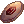
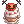
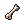
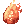
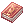
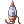

---
hide:
  - toc
updated: 2026-10-28
---

# Halloween Event 2026

{ .wiki-screenshot }

The dead of Niflheim are restless. Three ghost children, **Anes**, **Andrew** and **Silvano**, have slipped back into Prontera for one more Halloween, and the night is full of tricks, treats and old memories. Hunt the undead, play Trick or Treat with other players, help a grumpy old ghost get some sleep, relive seven Spooky Memories and protect a Valkyrie on her last stage. Spend your **Halloween Coins** at Silvano's costume shop.

!!! info "Quick Facts"
    - **Location:** Prontera (event NPCs) and Niflheim
    - **Levels:** all levels. Hard dailies and the Hollow need a strong character or a party
    - **Getting there:** **Watchful Anes** at `/navi prontera 54/214` takes you to Niflheim for free
    - **Duration:** about a month, starting October 21, 2026

| I want to... | Go to |
|--------------|-------|
| Earn coins every day | [Noisy Guests](#noisy-guests), [Event Monster Drops](#event-monster-drops), [Trick or Treat](#trick-or-treat) |
| Follow the event story | [Spooky Memories](#spooky-memories) |
| Get the Scatleton pet | [Spooky Memories](#spooky-memories) |
| Play with a party | [The Last Performance](#the-last-performance) |
| Buy costumes | [Shrewd Silvano's Shop](#shrewd-silvanos-shop) |

## Event Currency

| Currency | Used For |
|----------|----------|
|  **Halloween Coin** (`6658`) | The main event currency. Spend it at Shrewd Silvano's shop |
|  **Pumpkin Cake** (`11550`) | Food that restores 5% HP and 5% SP |
| **Pumpkin Treat Basket** (`22838`) | Use it on another player to play Trick or Treat |

!!! note "Account-bound"
    Halloween Coins and Pumpkin Cakes can't be traded, dropped, sold, mailed or put in a cart or guild storage. Put them in your Kafra storage to move them to another character on the same account.

## Activities

The Halloween Event offers **eight activities**. Do as many or as few as you like. Daily limits reset at midnight server time (check it with `@time`).

- 🎃 **Event Monster Drops**
  Coins and cakes from the undead, and a Pumpkinring that likes to say hello.
  [:octicons-arrow-down-24: Jump to](#event-monster-drops)

- 🍬 **Trick or Treat**
  Use baskets on other players and climb the weekly rankings.
  [:octicons-arrow-down-24: Jump to](#trick-or-treat)

- 👴 **Noisy Guests**
  A daily hunting task from Old Man Barnaby.
  [:octicons-arrow-down-24: Jump to](#noisy-guests)

- 📜 **Spooky Memories**
  A 7-day story quest, one day at a time.
  [:octicons-arrow-down-24: Jump to](#spooky-memories)

- 🦴 **The Hollow beneath Niflheim**
  The event hunting ground.
  [:octicons-arrow-down-24: Jump to](#the-hollow-beneath-niflheim)

- 🎭 **The Last Performance**
  A weekly party instance in a ruined theater.
  [:octicons-arrow-down-24: Jump to](#the-last-performance)

- 💣 **Bombring**
  An automatic survival event every two hours.
  [:octicons-arrow-down-24: Jump to](#bombring)

- 📈 **EXP Bonus Maps**
  Extra damage on the bonus maps.
  [:octicons-arrow-down-24: Jump to](#exp-bonus-maps)

### Event Monster Drops

Undead and Demon monsters, and monsters of the Undead, Ghost or Shadow element, can drop  **Halloween Coins** and  **Pumpkin Cakes** anywhere in the world.

- **Up to 50 coins and 50 cakes per account, per day** from monsters
- **Drops go straight into your inventory.** If you're overweight, the drop is lost
- **Your pet, homunculus, mercenary and elemental kills count**
- **Summoned and Dead Branch monsters don't drop event items**

!!! tip "Peek a boo!"
    Now and then a **Pumpkinring** pops out when you defeat a monster. It doesn't wait around, so be quick. Pumpkinrings carry coins, cakes and the **Pumpkin Treat Baskets** you need for Trick or Treat. They don't appear in instances or PvP maps, or once you've reached all of today's coin, cake and basket limits.

### Trick or Treat

Talk to **Mischievous Andrew** in **Prontera** `/navi prontera 58/217`.

1. Get **Pumpkin Treat Baskets** from Pumpkinrings (up to 15 per day).
2. Use a basket on another player.
3. You get +1 Tricked, and they get +1 Treated.

- **Each account once a day.** You can trick up to 15 different players a day
- **Not your own characters**, and not players with an open shop
- **A failed trick keeps your basket**

| Daily goal | Reward |
|------------|--------|
| Trick 5 players | The **Halloween Trick** buff for 30 minutes |
| Get treated 5 times and trick at least 1 player the same day | `20` Halloween Coin + `10` Pumpkin Cake by mail |

Andrew keeps two weekly rankings, **Most Tricked** and **Most Treated**. Every Monday at 00:00 server time the top 10 of each get Halloween Coins by mail, then the rankings reset. Talk to Andrew to see the rankings and your own count.

| Rank | Reward |
|------|--------|
| 🥇 #1 | `150` Halloween Coin |
| 🥈 #2 - #3 | `100` Halloween Coin |
| 🥉 #4 - #10 | `60` Halloween Coin |

### Noisy Guests

Talk to **Old Man Barnaby** in **Niflheim** `/navi niflheim 149/117`.

Monsters all over the world won't stop wailing and rattling their bones, and Barnaby hasn't slept in... well, he isn't sure. Pick **Easy** or **Hard**, and he gives you a random hunting task. Check your quest log for progress, then come back for your reward.

- **Once per day per account**
- **Kills count on any map.** Barnaby's task names the area to hunt in
- **Don't like your task?** Barnaby finds you a different one for `5`  Poring Coin (`7539`)

| Mode | Halloween Coin | Pumpkin Cake |
|------|----------------|--------------|
| Easy | `35-49` | `7-11` |
| Hard | `50-70` | `12-17` |

!!! danger "Hard means hard"
    Hard tasks send you after the big brutes. Bring friends!

### Spooky Memories

Talk to the **Grave-Herald** in **Niflheim** `/navi niflheim 288/269` to begin. A 7-day story quest, one chapter per day: after you finish a day, the next one opens after midnight server time. Each NPC tells you where to go next.

!!! warning "Once per account"
    Spooky Memories can be completed **once per account**, so pick the character you want to do it on.

| Day | Chapter | Where | Halloween Coin | Pumpkin Cake |
|-----|---------|-------|----------------|--------------|
| 1 | The Investigation | Niflheim | `30` | `10` |
| 2 | The Field Cleansing | Niflheim Fields | `35` | `10` |
| 3 | Scatelon's Secret | Alberta | `40` | `10` |
| 4 | Trick, Treat & the Pumpkin Shortage | Prontera | `42` | `10` |
| 5 | The Forgotten Enchanter | Niflheim | `45` | `15` |
| 6 | Jack's Lost Mojo | Izlude | `50` | `20` |
| 7 | Night of the Zombies | Payon | `70` | `30` |

All seven days add up to `312` Halloween Coin and `105` Pumpkin Cake.

!!! tip "Save your bones"
    Finishing Day 7 opens a ritual at the **Halloween Magician** that may wake a **Scatleton** of your own. Each try uses `10`  **Skelion Bone Fragments** (`25001`), so keep the ones you collect. One **Scatleton Egg** (`9101`) per account.

### The Hollow beneath Niflheim

Talk to **Old Man Barnaby** `/navi niflheim 149/117`, ask "Where's that dungeon?" and he takes you down.

The Hollow is home to Skelion, Garling, Disguise, Quve, Lude and Hylozoist. **Skelion** carries  **Skelion Bone Fragments** and  **Captured Souls** for the story and the Scatleton ritual. **Garling** carries the **Dried White Thin Stem** (`25422`) for the Costume Thorny Hairband in Silvano's shop.

- **Teleport, Fly Wing, warps, Dead Branch, Ice Wall, memo and vending don't work here**
- **You can't save here.** If you log out, you return to your save point
- **Butterfly Wing works**, and the exit portal takes you back to Niflheim

### The Last Performance

Talk to the **Spectral Usher** in **Niflheim** `/navi niflheim 198/184`.

A Valkyrie wants to restore the ruined theater for one last performance. Protect her through three waves.

1. Make a party. Every member must be on the Niflheim map.
2. The party leader talks to the Spectral Usher and chooses "I will protect the Valkyrie".
3. Inside, every member types `!ready` before the timer runs out.

| Rule | Detail |
|------|--------|
| **Party** | Required, the leader starts the run |
| **Limit** | Once per week per account, resets Monday at 06:00 server time |
| **Reward** | `25` Halloween Coin + `25` Pumpkin Cake |

- **If the Valkyrie dies, the performance fails.** You can't heal her, but she gets back 20% of her HP when the next wave starts
- **No EXP and no item drops inside**
- **Joining or leaving the party before the start cancels the run**
- **Logging out inside locks you out** of that run

!!! tip "Listen to the lost souls"
    Lost souls wander the stage during the fight. They're worth your attention.

### Bombring

The [Bombring](auto-events.md#bombring-event) auto event runs every odd hour at :30 (01:30, 03:30, 05:30 and so on). Type `@event` when registration opens, dodge the bombs and be the last one standing.

**Winner reward during the event:** `75`  Poring Coin + `25` Halloween Coin + `12` Pumpkin Cake.

### EXP Bonus Maps

During the event you deal 5% more damage to monsters on the current EXP bonus maps. Type `@mapexp` to see which maps have the bonus.

## Shrewd Silvano's Shop

Talk to **Shrewd Silvano** in **Prontera** `/navi prontera 62/217` and choose "Show me your wares." Every item costs Halloween Coins, most also cost Zeny, and some looks also need monster loot.

!!! note "Loot goes in your bag"
    Loot must be in your inventory, not in storage or a cart.

=== "Pets"

    | Item | Halloween Coin | Zeny | ID |
    |------|----------------|------|----|
    | Whisper Egg | `800` | 1,600,000z | `9045` |
    | Hylozoist Egg | `800` | 1,600,000z | `9179` |

=== "New Looks"

    | Item | Slot | Halloween Coin | Zeny | Loot | ID |
    |------|------|----------------|------|------|----|
    | Costume Pumpkin Hat | Upper | `600` | 1,200,000z | - | `20172` |
    | Costume Lude Mask | Middle + Lower | `550` | 750,000z | 50 Ectoplasm | `19918` |
    | Costume Vampire Hairband | Upper | `400` | 800,000z | - | `20098` |
    | Costume Orange Halloween Hat | Upper | `400` | 800,000z | - | `20174` |
    | Costume Chibi Beelzebub Hat | Upper | `400` | 800,000z | - | `31536` |
    | Costume Crow | Middle | `400` | 800,000z | - | `31380` |
    | Costume Nero Mask | Middle | `400` | 800,000z | - | `410098` |
    | Costume Pumpkin Toque | Upper | `400` | 800,000z | - | `20394` |
    | Costume Spider Poring | Middle + Lower | `400` | 800,000z | 15 Old White Cloth | `436010` |
    | Costume Crow Hat | Upper | `350` | 500,000z | 40 Glossy Hair | `19558` |
    | Costume Small Deviling Hat | Upper | `350` | 500,000z | 40 Golden Hair | `400565` |
    | Costume Thorny Hairband | Upper | `350` | 500,000z | 40 Dried White Thin Stem | `20460` |

    | Loot | Monster | Where | ID |
    |------|---------|-------|----|
    | Ectoplasm | Quve, Lude | Niflheim fields, the Hollow | `7220` |
    | Glossy Hair | Miyabi Doll | Amatsu Dungeon | `7152` |
    | Golden Hair | Marionette | Geffen Dungeon, Glast Heim | `1060` |
    | Dried White Thin Stem | Garling | The Hollow beneath Niflheim | `25422` |
    | Old White Cloth | Banshee, Grand Chamberlain | Nameless Island, Cursed Abbey, Old Glast Heim | `7751` |

=== "Past Halloweens"

    Costumes from earlier Halloween events are back.

    | Item | Slot | Halloween Coin | Zeny | ID |
    |------|------|----------------|------|----|
    | Costume Pumpkin Poring Bag | Garment | `750` | 1,500,000z | `20543` |
    | Costume Whisper Candy Pouch | Lower | `400` | 800,000z | `480494` |
    | Costume Vampire Familiar | Middle | `400` | 800,000z | `31120` |
    | Costume Halloween Pumpkin | Lower | `400` | 800,000z | `420597` |
    | Costume Zombie Mask | Middle | `400` | 800,000z | `31853` |
    | Costume Devil's Whisper | Middle | `400` | 800,000z | `19542` |
    | Costume Blink Eyes Halloween | Middle | `300` | 600,000z | `420596` |
    | Costume Jjakk | Upper | `300` | 600,000z | `31387` |
    | Costume Halloween Candy Hair | Upper | `300` | 600,000z | `420593` |
    | Costume Spider Seduction | Upper | `300` | 600,000z | `31596` |
    | Costume Camellia Demon Ribbon | Upper | `300` | 600,000z | `420015` |
    | Costume Jack Castle Bat | Lower | `300` | 600,000z | `20034` |
    | Costume Witch's Pumpkin Hat | Upper | `300` | 600,000z | `19903` |

=== "Halloween Items"

    | Item | Type | Halloween Coin | Zeny | ID |
    |------|------|----------------|------|----|
    | The Ripper | Katar, Level 70 | `250` | 500,000z | `610044` |
    | Witch's Broom | Staff, Level 60 | `200` | 400,000z | `26140` |
    | Jack O' Rush | Mace, Level 50 | `200` | 400,000z | `590112` |
    | Evil Cottonball | Taming item for Hylozoist | `50` | 100,000z | `107478` |

=== "Supplies"

    | Item | Halloween Coin | ID |
    |------|----------------|----|
    |  Battle Manual | `15` | `12208` |
    | JOB Battle Manual | `15` | `14592` |
    |  Speed Potion | `5` | `12016` |
    |  Life Insurance | `5` | `12209` |

## Key NPCs

| NPC | Location | Purpose |
|-----|----------|---------|
| Watchful Anes | `/navi prontera 54/214` | Free trip to Niflheim |
| Mischievous Andrew | `/navi prontera 58/217` | Trick or Treat rankings |
| Shrewd Silvano | `/navi prontera 62/217` | Halloween shop |
| Anes | `/navi niflheim 188/201` | Trip back to Prontera |
| Old Man Barnaby | `/navi niflheim 149/117` | Noisy Guests, entrance to the Hollow |
| Spectral Usher | `/navi niflheim 198/184` | The Last Performance |
| Grave-Herald | `/navi niflheim 288/269` | Spooky Memories, Day 1 |
| Vegetable Gardener | `/navi prontera 101/49` | Sells Pumpkin |

## Event Mobs

| Mob | Where | Notes |
|-----|-------|-------|
| **Pumpkinring** | Pops out when you defeat a monster | Carries coins, cakes and Pumpkin Treat Baskets. Gone in seconds, and stops appearing once you've hit all of today's limits |
| **Skelion** | The Hollow beneath Niflheim | Story materials and Skelion Bone Fragments for the Scatleton ritual |
| **Garling** | The Hollow beneath Niflheim | Story target. Carries Dried White Thin Stem for the Costume Thorny Hairband |

## FAQ

**Can I trade Halloween Coins?**

No. Put them in your Kafra storage to move them to another character on the same account.

**Is Spooky Memories per character or per account?**

Per account. You can do it once.

**When do the limits reset?**

Daily limits at midnight server time, Trick or Treat rankings on Monday at 00:00, and The Last Performance on Monday at 06:00.

**Can I trick the same player twice?**

Not on the same day. You can trick each account once a day.

---

**Happy Halloween!** 🎃
