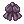

# Item Changes

Items, weapons and armor that work differently from the official game. See [What's Different](whats-different.md) for how to read the tables.

Items that uaRO added, removed or changed. Each row describes the item as it works on uaRO. Drop rates are listed in [Monster Changes](monster-changes.md).

## Weapon

| Item | Item ID | Description |
|-|-|-|
| Knuckle weapons | - | Size penalty 100% / 100% / 75% (Small / Medium / Large) |
| { #alca-bringer }  Alca Bringer | `1191`{ .copy } | Unbreakable Required Level 85 Equippable by Lord Knight and Paladin ASPD +1 per 2 refine levels  Acquisition: [Scaraba Hole](scaraba-hole.md#queen-scaraba): Queen Scaraba `2087`{ .copy } |
| { #black-wing }  Black Wing [2] | `13061`{ .copy } | Increases Backstab damage by 25% For each refine level above +6: ATK +5 Increases damage of Backstab by 5% 2 slots  Acquisition: [Biolabs 4](biolab4.md#biolabs-shop): Biolabs Shop |
| { #cannon-spear }  Cannon Spear [1] | `1435`{ .copy } | Max HP +500 Increases damage by 4% per refine level Increases Holy Cross damage by 3% per refine level  Acquisition: [Biolabs 4](biolab4.md#biolabs-shop): Biolabs Shop |
| { #catapult }  Catapult [2] | `18109`{ .copy } | DEX +2  At +7, +10% Ranged Physical damage and +10% ASPD  At +8, enables use of Long Range Snatcher when auto attacking  At +10, a further +10% Ranged Physical damage and +10% ASPD  Acquisition: [Biolabs 4](biolab4.md#biolabs-shop): Biolabs Shop |
|  Curved Sword [2] | `13405`{ .copy } | Equippable by Swordman, Merchant and Thief |
|  Death Fire [2] | `13192`{ .copy } | Required Level 95 Weapon Level 4 ATK 200 ASPD +3% per refine level At +7, DEX +3 At +9, Ranged Physical Damage +10% 2 slots |
|  Elder's Staff [2] | `26107`{ .copy } | Increases Healing skills effectiveness by 10%  MATK +15%. At +7, increases Healing effectiveness by 5% At +9, increases healing effectiveness by 10% (up to 25%) At +10, reduces after cast delay by 15% 2 slots  Acquisition: Conversion from a +10 Healing Staff at `/navi prt_church 20/25` |
|  Elemental Sword [3] | `13414`{ .copy } | Auto Bolt effect only works in the main hand. In the off hand it does not trigger or stack |
|  Elven Bow | `1746`{ .copy }, `35656`{ .copy } | Required Level 90 ATK 160 DEX +2 When equipped with Elven Arrow: Ranged Physical Damage +50% Set with Rogue's Treasure and Cold Heart: damage against Medium size monsters +20% No slots  Acquisition: 50% success rate risking a +10 Orc Archer Bow from the Elven Bow Artisan in the Payon weapon shop (`/navi payon_in01 5/126`) or the Hugel weapon shop (`/navi hu_in01 103/382`) The [1] version comes from S-tier slotting: 10% success rate for 5 Oridecon, 10 Steel and 2,000,000z |
|  Gigantic Lance [2] | `1490`{ .copy } | -10% ASPD At +7, -15% after cast delay At +8, -15% after cast delay At +9, -15% after cast delay (up to -45%) 2 slots  Acquisition: Conversion from +10 Trident at [Gigantic Lance Forger](custom-npc.md#weapon-forgers) |
|  Glorious Holy Avenger | `13418`{ .copy } | Gives a flat +6 INT on top of its existing refine-based INT bonus  Acquisition: Battlegrounds Weapon Shop |
|  Glorious Jamadhar | `1282`{ .copy } | Changed 20% defense ignore against demi-humans to be replaced with a straight +20% critical damage  Acquisition: Battlegrounds Weapon Shop |
|  Golden Wrench [2] | `1333`{ .copy } | Whitesmith only ATK 240 Required Level 85 STR +3 At +7, CRIT +20 At +8, ASPD +10% At +9, Base ATK +50 Indestructible in battle  Acquisition: Conversion from +10 Vecer Axe (50%) from the Golden Wrench Forger in the Geffen and Einbroch Smith job change areas (Geffen: `/navi geffen_in 102/176`, Einbroch: `/navi ein_in01 27/40`) |
| { #green-whistle }  Green Whistle [1] | `1930`{ .copy } | Increases Arrow Vulcan damage by 30% At +7, increase damage of Arrow Vulcan by 10% At +10, increase damage of Arrow Vulcan by 20% Decreases cast time of Arrow Vulcan by 2 seconds  Acquisition: [Biolabs 4](biolab4.md#biolabs-shop): Biolabs Shop |
|  Healing Staff | `1625`{ .copy } | Acquisition: Dropped by Anubis `1098`{ .copy }, Margaretha Sorin `1637`{ .copy } Drop rate: [Monster Changes](monster-changes.md) |
| { #imperial-spear }  Imperial Spear [1] | `1433`{ .copy } | Increases Shield Boomerang and Shield Charge damage by 20%, plus 1% each per refine Shield Chain SP cost -20 when combined with Imperial Guard  Acquisition: [Scaraba Hole](scaraba-hole.md#gear-and-drops): One-Horned Scaraba `2083`{ .copy } |
|  Inverse Scale | `1269`{ .copy }, `35650`{ .copy } | Slots can be added through S-tier socket crafting |
|  Lich's Bone Wand [2] | `1624`{ .copy } | Can be equipped by Soul Linker |
|  Luna Bow [2] | `1723`{ .copy } | DEF +2 At +6 or higher, DEF +3 At +9 or higher, DEF +5 |
| { #mental-stick }  Mental Stick [1] | `1654`{ .copy } | INT +3, MATK +20%, ASPD 10% At +7 or higher, adds an additional MATK +15% At +10, adds an additional MATK +20%  Acquisition: [Biolabs 4](biolab4.md#biolabs-shop): Biolabs Shop |
|  Muramasa | `1164`{ .copy }, `21003`{ .copy } | Slots can be added by Leablem, the S-class socket enchanter, turning a slotless Muramasa into the 2 slot version: 10% success rate for 2,000,000z, 5 Oridecon and 10 Steel. Failure destroys the weapon and the materials. Restricted in GvG |
| { #noble-cross }  Noble Cross [1] | `16029`{ .copy } | MATK +125 Adds a 5% chance to cast Turn Undead (Level 6) when dealing physical attack  Additional 1% chance for every refine +5 or above Recover 1 SP each time you hit an Undead monster Recover 12 SP each time you kill and Undead monster with physical attack  Equippable by Champion and High Priest  Acquisition: [Horror Toy Factory](horror-toy-factory.md#exchange-shop) |
| { #old-parasol }  Old Parasol [3] | `13442`{ .copy } | +5 ATK per refine level  Holy element  Acquisition: [Horror Toy Factory](horror-toy-factory.md#exchange-shop) |
| { #red-ether-bag }  Red Ether Bag [1] | `16010`{ .copy } | LUK +15, INT +5, DEX +1  Acquisition: [Biolabs 4](biolab4.md#biolabs-shop): Biolabs Shop |
|  Solar Sword | `1136`{ .copy } | Does not stack with other HP leech effects |
|  Staff of Piercing | `1644`{ .copy } | Can be equipped by Soul Linker |
| { #stem-whip }  Stem Whip [1] | `1984`{ .copy } | Increases Arrow Vulcan damage by 30% At +7, increase damage of Arrow Vulcan by 10% At +10, increase damage of Arrow Vulcan by 20% Decreases cast time of Arrow Vulcan by 2 seconds  Acquisition: [Biolabs 4](biolab4.md#biolabs-shop): Biolabs Shop |
| { #suras-rampage }  Sura's Rampage [1] | `1830`{ .copy } | Increases Finger Offensive damage by 20% Increases Occult Impact damage by 20% Increases SP cost of all skills by 5% Each refine above +5 decreases SP cost of skills by 1% At +7 or higher: Increases Finger Offensive and Occult Impact damage by 5% At +10: Increases Finger Offensive and Occult Impact damage by 10%  Acquisition: [Biolabs 4](biolab4.md#biolabs-shop): Biolabs Shop |
|  Thorn Staff of Darkness | `1636`{ .copy } | Can be equipped by Soul Linker  Can be slotted  Skull Cap combo (slotted and unslotted staff): the -10% cast time is only granted at +10 or higher MATK per refine is unchanged  Acquisition: Dropped by Entweihen Crothen `1957`{ .copy } |
|  Trident [2] | `1460`{ .copy } | Removed from the Prontera, Comodo and Einbroch weapon shops  Acquisition: Forgeable by Blacksmiths and drops from Merman `1264`{ .copy } |
| { #two-handed-chrome-metal-sword }  Two-Handed Chrome Metal Sword | `1196`{ .copy } | Required Level 85 Equippable by Lord Knight and Paladin Unbreakable AGI +3 MAX HP -10%  Acquisition: [Scaraba Hole](scaraba-hole.md#queen-scaraba): Queen Scaraba `2087`{ .copy } |
|  Vecer Axe [2] | `1311`{ .copy } | Dropped by Majoruros `1310`{ .copy } Drop rate: [Monster Changes](monster-changes.md) |
|  Veteran Axe [2] | `1384`{ .copy } | +10 ATK for each Forging skill (Dagger, Sword, Two-Handed Sword, Knuckle, Spear, Axe, Mace) at Level 2 or higher |

## Armor

| Item | Item ID | Description |
|-|-|-|
|  Advanced Assassin Mask | `18774`{ .copy } | Usable by all jobs |
|  Alchemy Glove [1] | `2854`{ .copy } | INT +2 Fire property magic damage +15% |
|  Angel Spirit | `5389`{ .copy } | Dropped by Valkyrie Randgris `1751`{ .copy } Drop rate: [Monster Changes](monster-changes.md) |
|  Angelic Protection [1] | `2355`{ .copy } | Can be enchanted at the Apprentice Craftsman High Grade Armor service in Prontera (`/navi prontera 165/60`) |
| { #assassins-handcuffs }  Assassin's Handcuffs [1] | `2892`{ .copy } | MAX HP +500  CRIT +8  CRIT DMG +10%  Acquisition: [Biolabs 4](biolab4.md#biolabs-shop) |
| { #bible-of-promise }  Bible of Promise [1] | `2162`{ .copy } | Required Level 90 High Priest only MDEF +5 INT +2 Increases healing effectiveness by 5%  Acquisition: [Biolabs 4](biolab4.md#biolabs-shop) |
|  Black Tail Ribbon [1] | `5765`{ .copy } | Acquisition: [Sabrina](woe.md#equipment), 15 WoE Equipment Tokens |
|  Blood Sucker | `18754`{ .copy } | Adds 1% chance of absorbing 3% physical damage inflected on target as HP  Disables natural HP and SP recovery |
|  Boitata Hat [1] | `5940`{ .copy } | Acquisition: Boitata `2068`{ .copy } |
| { #bone-plate }  Bone Plate [1] | `15000`{ .copy } | Can be enchanted at the Apprentice Craftsman High Grade Armor service in Prontera (`/navi prontera 165/60`) |
|  Book of Soyga | `19326`{ .copy } | Each card gives +5% experience from monsters of its race when equipped together: Armeyer Dinze (Fish), Anopheles (Insect), Orc Archer (Demi-Human), Grove (Formless), Baroness of Retribution (Angel), Stem Worm (Brute), Cloud Hermit (Plant), Dragon Egg (Dragon), Wraith (Undead), Raydric Archer (Demon) Required Level 20  Acquisition: [Dimonka](dimonka-headgear-quest.md) |
|  Bradium Brooch[1] | `2790`{ .copy } | Dropped by Bradium Golem `2024`{ .copy } Drop rate: [Monster Changes](monster-changes.md) |
| { #celines-ribbon }  Celine's Ribbon [1] | `18849`{ .copy } | DEX +3 MATK +20 MATK +1 per refine level 25 HP drain every 5 seconds Equippable by all Trans classes |
|  Chick Hat | `5283`{ .copy } | Reduces damage from Demi-Human and Brute monsters by 3% |
|  Crown of Deceit [1] | `5564`{ .copy } | Dropped by Fallen Bishop `1871`{ .copy } Drop rate: [Monster Changes](monster-changes.md) INT +3 Reduces cast time by 10% |
| { #dance-shoes }  Dance Shoes [1] | `2465`{ .copy } | AGI +1  ASPD +5%  Reduces the SP cost of Arrow Vulcan by 5  Acquisition: [Biolabs 4](biolab4.md#biolabs-shop) |
|  Defolty Doll Hat [1] | `5340`{ .copy } | Decreases damage from Demi-Human monsters by 5% Autocasts Angelus Level 10 when physically attacked within short range |
| { #evil-glove }  Evil Glove [1] | `2980`{ .copy } | MAX HP +300 MAX SP +50 INT +2 No level requirement. Equippable by all Trans jobs except Novice. |
| { #feral-boots }  Feral Boots | `2463`{ .copy } | Defense 2 |
| { #feral-tail }  Feral Tail | `2564`{ .copy } | Defense 3 |
|  Festival Pumpkin Hat | `5356`{ .copy } | All stats +3 Physical and magical damage against Demon monsters +5% Damage taken from Demon monsters -5% |
|  Forbidden Grimoire [1] | `28984`{ .copy } | ASPD +5%, INT +2 Refine Level +7 or Higher: Increases damage of Magic Elemental Earth Skills by 20% With Death Note: +1% MATK per refine of the Death Note, and -10% cast time at +10 |
| { #geffenia-water-book }  Geffenia Water Book [1] | `2161`{ .copy } | INT +2  MDEF +5  If base INT at least 90: MATK +30 and MAX HP +800  Acquisition: [Biolabs 4](biolab4.md#biolabs-shop) |
| { #gentle-heart }  Gentle Heart [1] | `2978`{ .copy } | STR +2 DEX +1 +5% damage to all races Required Level 90 Equippable by all Transcendent jobs |
|  Ghost Whisper [1] | `400396`{ .copy } | STR +3 At +7, +10% Meteor Assault damage At +9, STR +2 and a further +10% Meteor Assault damage |
|  Glaris Doll Hat | `5341`{ .copy } | Decreases damage from Demi-Human monsters by 5% INT +2 Recovers 50 HP when a monster is killed by a magical attack |
|  Golden Trinket | `2843`{ .copy } | MAX SP +50 Required Level 75  Acquisition: [El Dicastes](el-dicastes.md#spending-certificates): Jahbong, 1 Certificate |
| { #green-operation-coat }  Green Operation Coat [1] | `15044`{ .copy } | DEX +1, INT +3 Additional enchants available  Acquisition: [Biolabs 4](biolab4.md#biolabs-shop) |
|  Handkerchief in Mouth | `18670`{ .copy } | Acquisition: [Sabrina](woe.md#equipment), 15 WoE Equipment Tokens |
|  Hermode Cap[1] | `5481`{ .copy } | Dropped by Assassin Cross Eremes `1641`{ .copy } Drop rate: [Monster Changes](monster-changes.md) |
|  Holy Robe | `2327`{ .copy }, `2373`{ .copy } | Can be enchanted at the Apprentice Craftsman High Grade Armor service in Prontera (`/navi prontera 165/60`) |
| { #imperial-guard }  Imperial Guard [1] | `2153`{ .copy } | MDEF +5 Increases Shield Chain damage by 20%, plus 1% per refine At +8, halves Shield Chain cast time |
| { #light-of-el-dicastes }  Light of El Dicastes | `2844`{ .copy } | Untradeable and unrefinable, character bound Can go in personal storage, not guild storage Enchantable by Kareka in El Dicastes Grants Return to El Dicastes The unslotted standard version gives access to Scaraba Hole 2 through the [Vigilantes](scaraba-hole.md#vigilantes) |
|  Love Guard [1] | `18542`{ .copy } | Increases the effectiveness of your healing skills by 2% Increases the effect of received healing by 5% At +7 or higher, healing skills effectiveness +3%  Acquisition: [Dimonka](dimonka-headgear-quest.md) |
|  Mage Coat | `2334`{ .copy }, `2372`{ .copy } | Can be enchanted at the Apprentice Craftsman High Grade Armor service in Prontera (`/navi prontera 165/60`) |
|  Mercury Riser [1] | `18597`{ .copy } | Acquisition: Baphomet `1399`{ .copy } at 5.1% |
|  Mitra [1] | `5747`{ .copy } | MATK +10 at base INT 90 or higher Required Level 90 |
|  Ninja Suit | `2337`{ .copy }, `2359`{ .copy } | Can be enchanted at the Apprentice Craftsman High Grade Armor service in Prontera (`/navi prontera 165/60`) |
|  Novice Breastplate [1] | `2340`{ .copy } | Can be enchanted at the Apprentice Craftsman High Grade Armor service in Prontera (`/navi prontera 165/60`) |
|  Old Minstrel Song's Hat [1] | `18976`{ .copy } | Defense 3 All stats +1 Arrow Vulcan damage +20% For each 2 refine levels: ranged physical damage +1% Required Level 90 Clown and Gypsy only  Acquisition: [Dimonka](dimonka-headgear-quest.md) |
|  Old Mitra [1] | `18972`{ .copy } | INT +1 MDEF +5 For each 2 refine levels: MAX HP +1%, MAX SP +1%, ATK +8, MATK +4 and Magnus Exorcismus damage +4% Required Level 70 Priest only  Acquisition: Margaretha Sorin `1637`{ .copy } Drop rate: [Monster Changes](monster-changes.md) |
|  Puppy Hat | `5182`{ .copy } | Randomly autocasts Gloria when dealing physical attack At base AGI 77 or higher, the chance is 5% |
| { #red-lantern }  Red Lantern [1] | `2976`{ .copy } | Required Level 20  Equippable by All except Novice, Taekwon, Star Gladiator |
|  Robo Eye | `5325`{ .copy } | Dropped by Vesper `1685`{ .copy } Drop rate: [Monster Changes](monster-changes.md) |
|  Satanic Bone Helm [1] | `5529`{ .copy } | Required Level 1 |
|  Shinobi Sash | `2654`{ .copy }, `52290`{ .copy } | Slots can be added by Leablem: 5% success rate for 1,000,000z and 1 Elunium |
|  Sigrun's Wings | `5592`{ .copy } | Dropped by Gryphon `1259`{ .copy } Drop rate: [Monster Changes](monster-changes.md) |
|  Snake Head | `5388`{ .copy } | Dropped by Evil Snake Lord `1418`{ .copy } Drop rate: [Monster Changes](monster-changes.md) No slots |
|  Sting Hat | `5509`{ .copy } | Dropped by Sting `1207`{ .copy } Drop rate: [Monster Changes](monster-changes.md) |
|  Swordsman Medal of Honor | `2720`{ .copy } | Can be equipped by Taekwon |
| { #telekinetic-orb }  Telekinetic Orb | `2853`{ .copy }, `28530`{ .copy } | INT +3  MAX SP +30  Reduces damage and cast time of Lightning Bolt by 25%   Slots can be added by Seiyablem: 400,000z and 1 Elunium, 20% success rate. Failure destroys the item  Acquisition: [Biolabs 4](biolab4.md#biolabs-shop) |
|  Temporal AGI Boots | `22002`{ .copy } | MAX HP +300, MAX SP +30 For each 3 refine levels: MAX HP +100, MAX SP +10, ASPD +3% Base AGI at least 90: ASPD +3% |
|  Temporal DEX Boots | `22004`{ .copy } | MAX HP +300, MAX SP +30 For each 3 refine levels: MAX HP +100, MAX SP +10, DEX +1 Base DEX at least 90: Ranged Physical Damage +5% |
|  Temporal INT Boots | `22001`{ .copy } | MAX HP +300, MAX SP +30 For each 3 refine levels: MAX HP +100, MAX SP +10, INT +1, DEX +1 Base INT at least 90: MATK +5% |
|  Temporal LUK Boots | `22011`{ .copy } | MAX HP +300, MAX SP +30 For each 3 refine levels: MAX HP +100, MAX SP +10, Critical Damage +5% Base LUK at least 50: Critical Damage +10% Base LUK at least 70: Critical Damage +15% and MDEF +5 |
|  Temporal STR Boots | `22000`{ .copy } | MAX HP +300, MAX SP +30 For each 3 refine levels: MAX HP +100, MAX SP +10, STR +1 Base STR at least 90: ATK +5% |
|  Temporal VIT Boots | `22003`{ .copy } | MAX HP +500, MAX SP +30 For each 3 refine levels: MAX HP +200, MAX SP +10, MAX HP +4% Base VIT at least 75: MAX HP +10% |
|  Umbala Spirit | `18505`{ .copy } | Max HP +1% Increases the recovery rate of Meat by 25% Chance of dropping Meat when defeating monsters |
|  Valkyrie Drop | `28564`{ .copy } | Cast time -5% After skill delay -5% For each level of Impositio Manus: Magnus Exorcismus damage +4% Required Level 70 Priest only  Acquisition: Dropped by High Priest Margaretha `1649`{ .copy } Drop rate: [Monster Changes](monster-changes.md) |
|  Waterdrop Brooch [1] | `2787`{ .copy } | Dropped by Kraken `2202`{ .copy } Drop rate: [Monster Changes](monster-changes.md) |
|  Witch's Pumpkin Hat | `18656`{ .copy } | Defense 1  Acquisition: [Dimonka](dimonka-headgear-quest.md) |
| { #wounded-heart }  Wounded Heart [1] | `2977`{ .copy } | DEX +2 AGI +1 +5% damage to all races Required Level 90 Equippable by all Transcendent jobs |
|  Yellow Bandana | `5277`{ .copy } | Available from Sabrina for 15 WoE Tokens |
|  Yin Yang Earrings | `18576`{ .copy } | Chain Combo damage +10% Triple Attack damage +5% Combo Finish damage +5% When equipped with Hot-blooded Headband `5070`{ .copy }: Triple Attack and Combo Finish damage +5%, Tiger Fist and Chain Crush Combo damage +3% Required Level 70  Acquisition: [Dimonka](dimonka-headgear-quest.md) |

## Consumables

| Item | Item ID | Description |
|-|-|-|
|  Aspersio Scroll | `12217`{ .copy } | Acquisition: [Comodo Casino](comodo-casino.md) slot machines |
|  Aspersio Scroll Box (10) | `12915`{ .copy } | Acquisition: [Comodo Casino](comodo-casino.md) slot machines |
|  Bubble Gum | `12210`{ .copy } | [Poring Coin shop](poring-coins-system.md#consumable-items): 1,000 Poring Coins [Attendance reward](attendance-system.md) on login day 20 |
|  Convex Mirror | `12214`{ .copy } | 60 minute cooldown |
|  Cursed Water | `12020`{ .copy } | Bulk conversion at Niff Fountain, reached through the sign quest at `/navi niflheim 146/241`: choose Singular or All, based on your empty bottles. Includes a weight check |
|  Earth Elemental Converter | `12116`{ .copy } | Lasts **30** minutes |
|  Fantastic Cooking Kit | `12129`{ .copy } | Not consumed until a craft is attempted |
|  Field Manual 100% | `14533`{ .copy } | [Poring Coin shop](poring-coins-system.md#consumable-items): 40 Poring Coins [Attendance reward](attendance-system.md) on login day 10 Cannot be sold to NPCs or moved to the cart |
|  Fire Elemental Converter | `12114`{ .copy } | Lasts **30** minutes |
|  Fly Wing | `601`{ .copy } | Can be used while Berserked |
|  Golden Hammer | `614`{ .copy } | Not consumed until a craft is attempted |
|  Guarana Candy | `12414`{ .copy } | Up to 300 can be bought at once from the quest NPC |
|  Holy Arrow Quiver | `12183`{ .copy } | Inventor Jaax in Payon (`/navi payon_in01 5/133`) packs 500 Holy Arrows into a quiver for 500z |
|  Home Cooking Kit | `12126`{ .copy } | Not consumed until a craft is attempted |
|  Infinite Butterfly Wing | `52283`{ .copy } | Works like a Butterfly Wing: unusable during duels and on no-return maps  Acquisition: Exchanged at Lydia (`/navi prt_in 38/105`) |
|  Infinite Fly Wing | `12887`{ .copy } | Can be used while Berserked |
|  Life Insurance | `12209`{ .copy } | Lasts **30** minutes |
|  Iron Hammer | `613`{ .copy } | Not consumed until a craft is attempted |
|  Novice Fly Wing | `12323`{ .copy } | Can be used while Berserked |
|  Oridecon Hammer | `615`{ .copy } | Not consumed until a craft is attempted |
|  Outdoor Cooking Kit | `12125`{ .copy } | Not consumed until a craft is attempted |
| { #pet-accessory-box }  Pet Accessory Box | `16358`{ .copy } | Gives 1 random pet accessory out of 39, each with the same chance  Acquisition: [Hunting Missions](hunting-mission.md#mission-shop) shop for 30 Mission Points, [Comodo Casino](comodo-casino.md) slot machines |
|  Professional Cooking Kit | `12127`{ .copy } | Not consumed until a craft is attempted |
|  Royal Cooking Kit | `12128`{ .copy } | Not consumed until a craft is attempted |
|  Token of Siegfried | `7621`{ .copy } | 15 minute cooldown on resurrection use |
|  Water Elemental Converter | `12115`{ .copy } | Lasts **30** minutes |
|  Wind Elemental Converter | `12117`{ .copy } | Lasts **30** minutes |

## Misc

| Item | Item ID | Description |
|-|-|-|
|  Crystal Mirror | `747`{ .copy } | Dropped by Corrupted Monk `20898`{ .copy } Drop rate: [Monster Changes](monster-changes.md) |
|  Great Nature | `997`{ .copy } | Cannot be sent by mail |
|  Poring Coin | `7539`{ .copy } | Cannot be sold to NPCs |

## Extended Classes
Extended classes (Taekwon, Star Gladiator, Soul Linker, Ninja, and Gunslinger) can equip all armor listed as equippable by "All Transcendent Jobs" or similar. Temporal Boots and Variant Shoes can also be equipped by extended classes, excluding Novice.

For weapons, see [Expanded Class Weapons](expanded-class-weapons.md).

## Cards

Each row is the full description of the card as it works on uaRO.

| Card | Item ID | Description |
|---|---|---|
|  Abandoned Teddy Bear Card | `31022`{ .copy } | Max SP +20% 1% chance to inflict Curse on the wearer when dealing physical or magical attacks. |
|  Celine Kimi Card | `31023`{ .copy } | MATK +10% Adds a 2% chance of inflicting Critical Wound on any target within 11x11 cells of the user when performing a magical attack. Adds an additional 0.5% chance of inflicting Critical Wound per refine level of the compounded item |
|  Clock Card | `4299`{ .copy } | When hit, 3% chance to cast Auto Guard Level 3 (Level 10 if you know Auto Guard Level 10). A proc while Auto Guard is active refreshes its timer instead of cancelling it. |
|  Dancing Marionette Card | `31021`{ .copy } | Increases ASPD by 2% Decreases ATK by 3% |
|  Isilla Card | `4412`{ .copy } | INT +2 5% chance when dealing magic damage to reduce cast time by 50% and give Flee +30 for 5 seconds. Also triggers from AoE magic skills, not only single target magic. |
|  Khalitzburg Knight Card | `4609`{ .copy } | DEF +3 Decreases Physical and Magical Damage taken from Medium and Large size by 20% |
|  Kraken Card | `4525`{ .copy } | FLEE +10 Increases resistance to all elemental properties by 25%. Enables the use of Level 1 Hiding. |
|  Moonlight Flower Card | `4131`{ .copy } | Movement speed +40%. |
| { #myst-case-card }  Myst Case Card | `4206`{ .copy } | Adds a 2.25% chance for monsters to drop a Gift Box `644`{ .copy }. |
|  Queen Scaraba Card | `4507`{ .copy } | Inflicts 30% more damage against Scaraba monsters MDEF -30 Flee -30 Deals more magical damage depending on the target's magic defense Small chance of dropping a Scaraba Summoning Scroll `12806`{ .copy } when defeating any monster |
|  Shinobi Card | `4230`{ .copy } | AGI +1 10% chance to cast Cloaking Level 5 when hit The Cloaking chance is nullified when the Thief card set is equipped together: The Paper Card `4172`{ .copy }, Wanderer Card `4210`{ .copy }, Shinobi Card, Wild Rose Card `4257`{ .copy } and Zhu Po Long Card `4272`{ .copy } |
|  White Knight Card | `4608`{ .copy } | Increases Physical Damage against Medium and Large size by 15% With Khalitzburg Knight Card: Physical Damage against Medium and Large size +10%, damage taken from Medium and Large size -10% |

