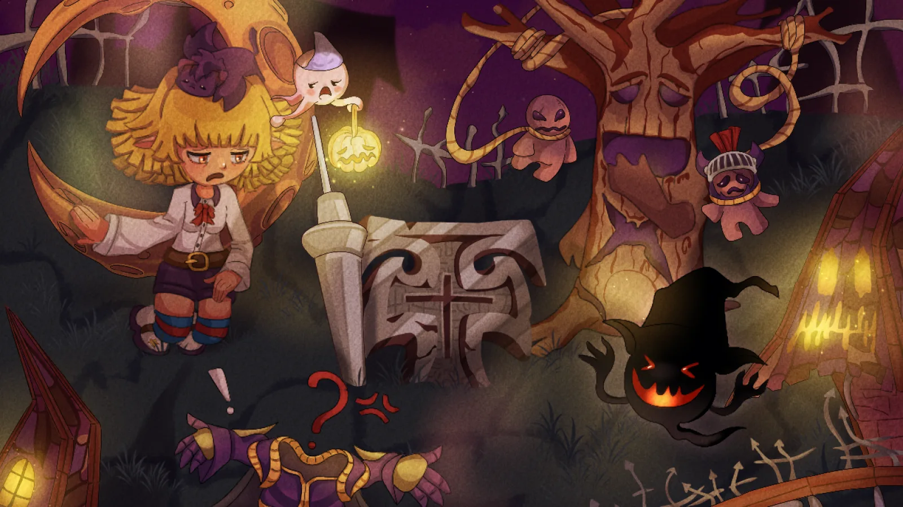
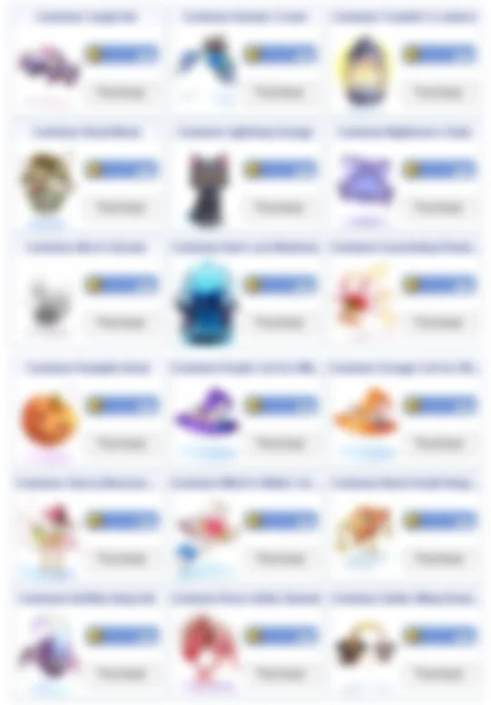

# Patch Notes - October 21, 2026

!!! warning "Important"
    Make sure your client is patched using the patcher -
    this is important to avoid in-game errors and crashes.

---

## 🎃 Halloween Event 2026

!!! success "Event Now Live"
    The dead of Niflheim are restless! The Halloween Event 2026 has started and runs for about a month.

[{ .wiki-screenshot }](../../halloween-event-2026.md)

Hunt the undead for **Halloween Coins**, play Trick or Treat with other players, help **Old Man Barnaby** every day, relive seven **Spooky Memories** and protect the Valkyrie in **The Last Performance**. Spend your coins at **Shrewd Silvano**'s costume shop in Prontera.

:point_right: **[Halloween Event 2026 Guide](../../halloween-event-2026.md)**

---

## 🎮 Gameplay

### Autotrade 2

**Autotrade 2** is now live! Set up your vending shop or buying store as usual, then type `@at2`.

- Your shop stays open while you go back to character select, so you can keep playing on the same account. To close the shop, log back into the vendor.
- The vendor counts as offline, unlike with `@at`.
- You can have as many characters on the account vending at the same time.
- It makes it easier to vend and move items on one account if you want to consolidate.
- The one-entry-per-stackable-item limit still applies.
- `@vendrecap` works the same as with `@at`.

!!! note "@at Still Works"
    The regular `@at` command is unchanged and can still be used.

### Card Drop Announcements

Card drop announcements have been reworked:

- The announcement now goes to the player who actually loots the card (autoloot, pet loot or picked up), with their name. This avoids confusion for players outside the loot requirements (cell range, etc.).
- Cards received through party loot share don't show a kill count, only which copy of that card the player received.
- Cards looted by your pet are credited to you.
- Kills made by your homunculus, mercenary, elemental or pet now count towards your kill count.

### Other Changes

| Change | Description |
|--------|-------------|
| **Vending & Buying Stores** | Skills can no longer be used while your vending shop or buying store is open |
| **Battlegrounds** | **Tuxedo** and **Wedding Dress** are now disabled in Battlegrounds |

---

## 👾 Monsters

| Change | Description |
|--------|-------------|
| **Boitata** | Fixed the **Boitata Hat** drop chance: now `3%` (was `0.3%`) |

---

## 🎒 Items

| Item | Changes |
|------|---------|
| **Enchanted Peach Tree Card**, **Zipper Bear Card** | No longer announced when dropped |
| **White Lady Pet** | Can no longer equip **Circular Headgear** as an accessory |

---

## 🛒 Cash Shop

| Change | Description |
|--------|-------------|
| **Costume Pigeon On Shoulder** | Removed from the Cash Shop. Still available at **Felicia** for `12` **Gold Coins** |

!!! tip "New Costumes Available!"
    New items have been added to the Cash Shop.

{ .wiki-screenshot }

---

## 🛠️ Fixes

| Fix | Description |
|-----|-------------|
| **AFK Display** | The AFK display is now an effect and works together with your existing costumes |
| **Show Equipment** | The Show Equipment checkbox now loads your saved preference at login, so your costumes are no longer shown when you turned it off |
| **Zac (Hat Maker)** | Moved **Zac** in Prontera slightly. He was standing on the same spot as **Mewry the Collector** |

---

## 🌟 **We Need Your Support!**

We kindly ask everyone to take **`5 minutes`** to leave a review for our server on **RMS**! Your feedback is
crucial to helping us reclaim the **top spot** and showing why we're the **best server in the world**.

Leave your review here: [Rate our server on RMS!](https://ratemyserver.net/index.php?page=detailedlistserver&serid=22102&itv=6&url_sname=UARO%20World%20of%20your%20dream)

---
