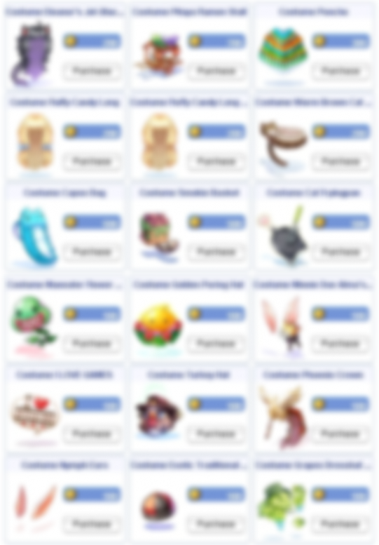

# Patch Notes - November 24, 2026

!!! warning "Important"
    Make sure your client is patched using the patcher -
    this is important to avoid in-game errors and crashes.

---

## 📬 RoDEX (Mail) Rework

The mail system was reworked to fix bugs that existed since the very beginning of the server.

- Items and zeny no longer disappear when sending a mail fails. They come back to you as **Undelivered mail**, together with the postage.
- Your character is now saved right after sending or claiming mail, so a server crash can no longer undo it.
- A mail that still holds zeny or items can no longer be deleted. Take them out first (before, deleting it destroyed the attachments).
- Attachments that don't fit in your inventory are mailed back to you as **Undelivered attachments**.
- The **Return** button now works. The sender gets the mail back in their return box.
- Expired mail now returns to the sender if it was unread or still has attachments.
- You now get a message when RoDEX can't be used: while trading, vending or dead, and in castles during WoE.

:point_right: **[QOL Improvements](../../improvements.md#rodex-mail-system)**

---

## 💀 Niflheim Dungeon

!!! tip "Redemption Shop Coming Next Week"
    The **Niflheim Dungeon** redemption shop has been finalized, based on a mix of player input and admin adaptations. It is in its final testing phase and will be released with next week's maintenance.

    Keep grinding your **Zelunium** and **Shadowdecon** to get a head start!

:point_right: **[Niflheim Dungeon](../../niflheim-dungeon.md)**

---

## 🎮 Gameplay

### Bulk Arrow Crafting

Added bulk crafting for **Arrow Crafting**:

- Open `@settings` > **Character Settings** > **Arrow Crafting Amount** on a character that has learned **Arrow Crafting**.
- Set how many crafts you want to run, from `1` to `300`.
- Each use crafts your set amount, or the most your items, free inventory space and weight allow.

### Other Changes

| Change | Description |
|--------|-------------|
| **Armor Element Icons** | Added status icons that show when your armor element changes, from equipment or cards (**Evil Druid Card**, etc.) and from statuses like **Frozen**, **Stone Curse** or **Benedictio** |
| **Hunting Missions** | Added a client side quest cooldown for **Hobota** missions. The **Hunting Mission Cooldown** now shows in your quest log |
| **Autoloot & Show Rare** | Autoloot and `showrare` can now be set with decimals (`0.05`, etc.), down to a minimum of `0.01` |
| **Life Potions** | Now show the real remaining time after relog, and end on their last heal |
| **Death Witch** | Now stays inside its MVP area in the north of **Niflheim Dungeon** floor `2` and can't be pulled out of it |
| **Bombring Event** | Items can no longer be used during the event, and equipment gives no stats there. Costumes still show |
| **`@vendrecap`** | Totals are no longer capped at `1,000,000,000z`, and your recap is kept if opening a shop fails |

---

## 🏛️ El Dicastes

- Added a safe zone around the cat merchants on `dic_fild01`:
    - You can't enter it if you were in combat in the last `10` seconds (the same rule as logging out).
    - While inside, you can't attack or use skills.
    - Monsters can't enter the zone.
- Daily quests are now received and turned in at the quest givers in the city square: **Laponte**, **Kalipo**, **Pura**, **Tragis**, **Calyon** and **Moltuka**. The northern map is still used for the one-time introduction quest.
- Daily quests no longer expire, so take your time to finish them. After you turn one in, that quest giver has a new request after the daily reset (`00:00` server time).
- You can now give up a request at its quest giver. You get a new one after the daily reset.

:point_right: **[El Dicastes](../../el-dicastes.md)**

---

## ⚔️ Skills

| Skill | Changes |
|-------|---------|
| **Cleaner** / **Flag Graffiti** (Rogue) | Removed these unfinished skills from the Rogue skill tree. If you put points into them, they are refunded after maintenance |
| **Graffiti** (Rogue) | No longer requires **Cleaner** or **Flag Graffiti** |
| **Abracadabra** (Sage / Professor) | Can no longer be used on PvP maps |

:point_right: **[Class Changes](../../class-changes.md)**

---

## 🚩 Battlegrounds

- The Battlegrounds interface is now part of the `Ctrl+G` window:
    - It shows your team, the arena goal, your win streak and unclaimed badges.
    - Team chat now goes through this window. The `#team`, `#team1` and `#team2` channels are removed, `#bg` stays.
- Enemy guild members now show only their name and the sword icon, instead of their own guild information. The sword icon also reappears properly when **Cloaking** or **Hiding** ends.

:point_right: **[Battlegrounds](../../battlegrounds.md)**

---

## 🏰 WoE

| Change | Description |
|--------|-------------|
| **Card Block Review** | The new **Niflheim Dungeon** cards have been reviewed for proper blocking within WoE and Pre-Trans WoE |
| **Kriemhild Treasure Chests** | Loot updated. See the treasure chest tables on [War of Emperium](../../woe.md#treasure-chest-drop) and [Pre-Trans WoE](../../pre-trans-woe.md#treasure-chest-drop) |

---

## 🔧 Fixes

| Fix | Description |
|-----|-------------|
| **Show Rare** | The client side drop display now follows the player who actually looted the item, not the killer, to match the global card announcement |
| **Celine Kimi Card** | Now properly applies Level `3` **Critical Wounds** |
| **`/showshop` & `/emblem`** | Your choice is now saved with your settings and kept after logout |
| **Baby Classes** | Fixed a visual glitch after changing to a baby class that showed fewer skill points than you have until your first allocation |
| **Lude Gal Card & Ghost Cube Card** | Fixed a script error, so their bonuses apply to the whole Novice family instead of only the base job |
| **No-Party PvP Maps** | Fixed party members not being treated as enemies on no-party PvP maps (**PvP Arena**, etc.) |
| **Alice Wig** | The costume now uses the lower costume slot |

---

## 🛒 Cash Shop

!!! tip "New Costumes Available!"
    New costumes have been added to the Cash Shop. Grab yours in the **New** tab!

{ .wiki-screenshot }

---

## 🌟 **We Need Your Support!**

We kindly ask everyone to take **`5 minutes`** to leave a review for our server on **RMS**! Your feedback is
crucial to helping us reclaim the **top spot** and showing why we're the **best server in the world**.

Leave your review here: [Rate our server on RMS!](https://ratemyserver.net/index.php?page=detailedlistserver&serid=22102&itv=6&url_sname=UARO%20World%20of%20your%20dream)

---
