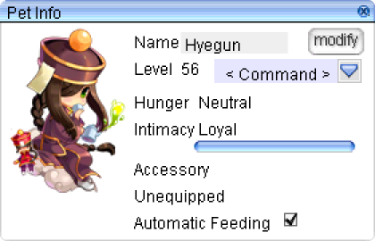

# Cute Pet System

Pets follow you through every adventure and give you a bonus once they trust you enough. This page covers how to tame, feed and evolve them, and lists every pet with its taming item, food and bonus.

!!! info "Quick Start"
    1. Use the pet's taming item on its monster.
    2. Feed it, or turn on [auto-feed](#auto-feed).
    3. Reach Loyal, then evolve it if it can.

## How It Works

- Use a pet's taming item on the monster. The taming item and where it comes from are on its card in [All Pets](#all-pets).
- Keep it fed. A hungry pet loses intimacy, and one that starves returns to its egg at Awkward intimacy instead of running away.
- Its bonus depends on intimacy. Each card lists the Loyal bonus, and the lower levels where a pet has them.
- A pet must be at Loyal intimacy to evolve. The materials are on the pet it evolves from, under "Evolves into".
- Swap to another egg with a [**Pet Incubator**](#pet-switch) (`643`), or turn a loyal pet into a permanent skin at the [Pet Stylist](#pet-stylist).

## Taming

Most taming items drop from monsters, or come from the  [**Taming Gift Set**](taming-gift-set.md) (`12105`). To find which monsters drop a taming item, use `@whodrops` or `@ii` in game. Drops that uaRO added are listed in [Monster Changes](monster-changes.md).

- Taming items are only used up when the target is valid.
- The success rate doubles when the monster is under 1% HP.
- Non-evolved pets are all in the Taming Gift Set, so their taming items can come from it.
- Abracadabra gives a non-evolved pet the same chance of success as its taming item. An evolved pet has a 0.01% chance through Abracadabra.

!!! warning "Bacsojin Tamed With Abracadabra"
    The Bacsojin you get from the Abracadabra skill does not have any bonuses. It is used as a costume. Evolve an **Evil Nymph** into a Bacsojin and the pet has all of its bonuses.

    Check that a Bacsojin comes with a bonus before you buy one.

## Feeding

Each pet eats the food shown under "Food" on its card in [All Pets](#all-pets). Hunger drops over time, and feeding a hungry pet raises its intimacy.

### Hunger

- Hunger drops by 3 points every 60 seconds, for all pets.
- Feed a pet when it is hungry. One that is already full loses intimacy when you feed it, and one that is only a little hungry gains less.
- A pet that starves goes back to its egg at Awkward intimacy instead of running away.

### Auto-Feed

Auto-feed is available for evolved pets and for pets without an evolution. The "Auto-feed" line under "Food" on each card in [All Pets](#all-pets) says whether a pet can be auto-fed.

To turn it on:

{ .wiki-screenshot .wiki-screenshot-right }

1. Open your pet window (`ALT+J` or right click).
2. Select the checkbox next to "Automatic feeding" at the bottom of the window. If you don't see it, that pet can't be auto-fed.

!!! warning "Enable Auto-Feed Before You Leave"
    A pet that starves returns to its egg with intimacy at Awkward. Turn on auto-feed before you leave a pet unattended.

### Intimacy

Intimacy is how much your pet likes you. It sets which bonus you get, and a pet must reach Loyal to evolve. The maximum is 1,000.

| Level | Intimacy needed |
|---|---|
| Awkward | 1 |
| Shy | 100 |
| Neutral | 250 |
| Cordial | 750 |
| Loyal | 900 |

### Intimacy per Feeding

Every feeding raises intimacy, and the amount depends on the pet:

| Pet | Intimacy per feeding |
|---|---|
| Evolved, first tier | 40 |
| Evolved, second or final | 30 |
| Evolved, third and final | 20 |
| Non-evolvable | 30 |
| Phreeoni (MVP, final) | 20 |
| Incubus and Succubus | 20 |

### Reaching Loyal

- A new pet starts at Neutral, so it needs 650 more intimacy to reach Loyal. That is about 22 feedings for a pet that gains 30 each time.
- Turn on [auto-feed](#auto-feed) and the pet feeds itself while you are away.
- Your pet loses 5 intimacy each time you die.

## Pet Switch

Use a **Pet Incubator** while a pet is out to swap directly to another pet egg.

- Your current pet returns to its egg, which needs 1 free inventory slot.
- The Pet Incubator is only used when you pick an egg. Closing the list doesn't waste it.
- Your [Pet Stylist](#pet-stylist) skin is kept when you switch pets.

## Pet Stylist

Talk to the **Pet Stylist** in Prontera (`/navi prontera 218/224`), directly north of the Pet Groomer, to permanently swap your pet's skin.

- The pet must be loyal and out when you talk to the Pet Stylist.
- The cost is the pet itself. It returns to its egg and the egg is consumed, so it is not turned back into an egg afterwards.
- The skin is account wide, and you can apply it to any pet. It persists through logout.
- A Pet Incubator switch keeps the skin (see [Pet Switch](#pet-switch)).

!!! warning "Reverting to Egg"
    Returning a pet to its egg reverts it to the default appearance when it is rehatched, regardless of the skin applied. A Pet Incubator switch keeps your skin (see [Pet Switch](#pet-switch)).

## Hiding Pets

- The "Mute Pets" option in `@settings` hides all pet talk and emotes for you only. Pets still function normally and other players are unaffected.
- During the [Bombring event](auto-events.md#bombring-event), pets hide automatically and are not stored to their egg.

## All Pets

Every pet on the server, with its bonus, taming item, food and evolution.

??? note "How to Read This Table"
    - **Title bar.** The pet's egg and name, then its stage: Base Form (it can evolve), Evolution 1, Evolution 2 and so on, Final Evolution, or No Evolution for a pet that stands alone.
    - **Egg ID and Mob ID.** The Egg ID is the egg item you get. The Mob ID is the monster you tame, so a pet that can't be tamed shows only an Egg ID.
    - **Loyal bonus.** What the pet gives you at Loyal intimacy. Open the toggle under it for the lower levels, where a pet has them.
    - **Accessory.** The accessory that goes with the pet, under its bonus. Pets without one have no Accessory section.
    - **Taming item.** What you use on the monster, where it comes from, and the capture rate. A pet you can't tame shows "Egg" instead, with where the egg comes from.
    - **Food.** What the pet eats, and whether it can be auto-fed.
    - **Evolution.** What the pet evolves from and into. Open "Requirements" to see the materials for each evolution.

<!-- PET_TABLE -->
