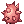
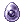
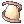
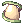
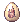
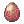
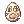
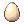

# Taming Gift Set

 The **Taming Gift Set** (`12105`{ .copy }) is a beautifully decorated gift set that contains a taming item for the [Cute Pet System](pet-system.md). Using it gives you a random one of the items below, shown with the monster it tames and that monster's egg.

## How to Acquire

- **Hobota**, who is in every inn, has it in the Mission Shop for 35 Mission Points. See [Hunting Missions](hunting-mission.md#mission-shop).
- **Wayne** in Hugel (`/navi hugel 71/83`) gives 2 for 42 Prize Medals. See the [Hugel Mini Game](hugel-mini-game.md).
- The [Comodo Casino](comodo-casino.md) slot machines pay it out as one of the Tier 2 (Very Rare, `3.60%`) prizes.

## Items

| Item | Mob | Egg |
|-|-|-|
|  Orange Juice (`620`{ .copy }) | [Drops](pet-system.md#pet-drops) (`1113`{ .copy }) |  Drops Egg (`9002`{ .copy }) |
|  Bitter Herb (`621`{ .copy }) | [Poporing](pet-system.md#pet-poporing) (`1031`{ .copy }) |  Poporing Egg (`9003`{ .copy }) |
|  Rainbow Carrot (`622`{ .copy }) | [Lunatic](pet-system.md#pet-lunatic) (`1063`{ .copy }) |  Lunatic Egg (`9004`{ .copy }) |
|  Earthworm the Dude (`623`{ .copy }) | [Picky](pet-system.md#pet-picky) (`1049`{ .copy }) |  Picky Egg (`9005`{ .copy }) |
|  Rotten Fish (`624`{ .copy }) | [Chonchon](pet-system.md#pet-chonchon) (`1011`{ .copy }) |  Chonchon Egg (`9006`{ .copy }) |
|  Rusty Iron (`625`{ .copy }) | [Steel Chonchon](pet-system.md#pet-steel-chonchon) (`1042`{ .copy }) |  Steel Chonchon Egg (`9007`{ .copy }) |
|  Monster Juice (`626`{ .copy }) | [Hunter Fly](pet-system.md#pet-hunter-fly) (`1035`{ .copy }) |  Hunter Fly Egg (`9008`{ .copy }) |
|  Sweet Milk (`627`{ .copy }) | [Savage Babe](pet-system.md#pet-savage-babe) (`1167`{ .copy }) |  Savage Bebe Egg (`9009`{ .copy }) |
|  Well-Dried Bone (`628`{ .copy }) | [Baby Desert Wolf](pet-system.md#pet-baby-desert-wolf) (`1107`{ .copy }) |  Baby Desert Wolf Egg (`9010`{ .copy }) |
|  Singing Flower (`629`{ .copy }) | [Rocker](pet-system.md#pet-rocker) (`1052`{ .copy }) |  Rocker Egg (`9011`{ .copy }) |
|  Dew-Laden Moss (`630`{ .copy }) | [Spore](pet-system.md#pet-spore) (`1014`{ .copy }) |  Spore Egg (`9012`{ .copy }) |
|  Deadly Noxious Herb (`631`{ .copy }) | [Poison Spore](pet-system.md#pet-poison-spore) (`1077`{ .copy }) |  Poison Spore Egg (`9013`{ .copy }) |
|  Fatty Chubby Earthworm (`632`{ .copy }) | [PecoPeco](pet-system.md#pet-pecopeco) (`1019`{ .copy }) |  PecoPeco Egg (`9014`{ .copy }) |
|  Sweet Potato (`633`{ .copy }) | [Smokie](pet-system.md#pet-smokie) (`1056`{ .copy }) |  Smokie Egg (`9015`{ .copy }) |
|  Tropical Banana (`634`{ .copy }) | [Yoyo](pet-system.md#pet-yoyo) (`1057`{ .copy }) |  Yoyo Egg (`9016`{ .copy }) |
|  Orc Trophy (`635`{ .copy }) | [Orc Warrior](pet-system.md#pet-orc-warrior) (`1023`{ .copy }) |  Orc Warrior Egg (`9017`{ .copy }) |
|  No Recipient (`636`{ .copy }) | [Munak](pet-system.md#pet-munak) (`1026`{ .copy }) |  Munak Egg (`9018`{ .copy }) |
|  Old Broom (`637`{ .copy }) | [Dokebi](pet-system.md#pet-dokebi) (`1110`{ .copy }) |  Dokebi Egg (`9019`{ .copy }) |
|  Silver Knife of Chastity (`638`{ .copy }) | [Sohee](pet-system.md#pet-sohee) (`1170`{ .copy }) |  Sohee Egg (`9020`{ .copy }) |
|  Armlet of Obedience (`639`{ .copy }) | [Isis](pet-system.md#pet-isis) (`1029`{ .copy }) |  Isis Egg (`9021`{ .copy }) |
|  Shining Stone (`640`{ .copy }) | [Green Petite](pet-system.md#pet-green-petite) (`1155`{ .copy }) |  Green Petite Egg (`9022`{ .copy }) |
|  Contract in Shadow (`641`{ .copy }) | [Deviruchi](pet-system.md#pet-deviruchi) (`1109`{ .copy }) |  Deviruchi Egg (`9023`{ .copy }) |
|  Book of the Devil (`642`{ .copy }) | [Baphomet Jr.](pet-system.md#pet-baphomet-jr) (`1101`{ .copy }) |  Bapho Jr. Egg (`9024`{ .copy }) |
|  Her Heart (`659`{ .copy }) | [Bongun](pet-system.md#pet-bongun) (`1188`{ .copy }) |  Bongun Egg (`9025`{ .copy }) |
|  Forbidden Red Candle (`660`{ .copy }) | [Zealotus](pet-system.md#pet-zealotus) (`1200`{ .copy }) |  Zealotus Egg (`9026`{ .copy }) |
|  Soft Apron (`661`{ .copy }) | [Alice](pet-system.md#pet-alice) (`1275`{ .copy }) |  Alice Egg (`9027`{ .copy }) |
|  Luxury Whisky Bottle (`12367`{ .copy }) | [Dullahan](pet-system.md#pet-dullahan) (`1504`{ .copy }) |  Dullahan Egg (`9049`{ .copy }) |
|  Charming Lotus (`12365`{ .copy }) | [Evil Nymph](pet-system.md#pet-evil-nymph) (`1416`{ .copy }) |  Wicked Nymph Egg (`9047`{ .copy }) |
|  Knife Goblin Ring (`14569`{ .copy }) | [Knife Goblin](pet-system.md#pet-knife-goblin) (`1122`{ .copy }) |  Knife Goblin Egg (`9032`{ .copy }) |
|  Flail Goblin Ring (`14570`{ .copy }) | [Flail Goblin](pet-system.md#pet-flail-goblin) (`1535`{ .copy }) |  Flail Goblin Egg (`9033`{ .copy }) |
|  Hammer Goblin Ring (`14571`{ .copy }) | [Hammer Goblin](pet-system.md#pet-hammer-goblin) (`1537`{ .copy }) |  Hammer Goblin Egg (`9034`{ .copy }) |
|  Staff Of Leader (`12364`{ .copy }) | [Goblin Leader](pet-system.md#pet-goblin-leader) (`1299`{ .copy }) |  Goblin Leader Egg (`9046`{ .copy }) |
|  Very Red Juice (`12360`{ .copy }) | [Loli Ruri](pet-system.md#pet-loli-ruri) (`1505`{ .copy }) |  Loli Ruri Egg (`9042`{ .copy }) |
|  Magical Lithography (`12371`{ .copy }) | [Golem](pet-system.md#pet-golem) (`1040`{ .copy }) |  Golem Egg (`9053`{ .copy }) |
|  Tantan Noodle (`12395`{ .copy }) | [Chung E](pet-system.md#pet-chung-e) (`1519`{ .copy }) |  Green Maiden Egg (`9030`{ .copy }) |
|  Ice Fireworks (`12374`{ .copy }) | [Imp](pet-system.md#pet-imp) (`1837`{ .copy }) |  Imp Egg (`9056`{ .copy }) |
|  Fan Of Wind (`12358`{ .copy }) | [Civil Servant](pet-system.md#pet-civil-servant) (`1513`{ .copy }) |  Civil Servant Egg (`9040`{ .copy }) |
|  Girl's Naivety (`12370`{ .copy }) | [Incubus](pet-system.md#pet-incubus) (`1374`{ .copy }) |  Incubus Egg (`9052`{ .copy }) |
|  Very Soft Plant (`12359`{ .copy }) | [Leaf Cat](pet-system.md#pet-leaf-cat) (`1586`{ .copy }) |  Leaf Cat Egg (`9041`{ .copy }) |
|  Delicious Shaved Ice (`12361`{ .copy }) | [Marionette](pet-system.md#pet-marionette) (`1143`{ .copy }) |  Marionette Egg (`9043`{ .copy }) |
|  Splendid Mirror (`12368`{ .copy }) | [Medusa](pet-system.md#pet-medusa) (`1148`{ .copy }) |  Medusa Egg (`9050`{ .copy }) |
|  Girl's Doll (`12366`{ .copy }) | [Miyabi Doll](pet-system.md#pet-miyabi-doll) (`1404`{ .copy }) |  Miyabi Ningyo Egg (`9048`{ .copy }) |
|  Hell Contract (`12372`{ .copy }) | [Nightmare Terror](pet-system.md#pet-nightmare-terror) (`1379`{ .copy }) |  Nightmare Terror Egg (`9054`{ .copy }) |
|  Kuloren (`12362`{ .copy }) | [Shinobi](pet-system.md#pet-shinobi) (`1401`{ .copy }) |  Shinobi Egg (`9044`{ .copy }) |
|  Oilpalm Coconut (`12369`{ .copy }) | [Stone Shooter](pet-system.md#pet-stone-shooter) (`1495`{ .copy }) |  Stone Shooter Egg (`9051`{ .copy }) |
|  Boy's Pure Heart (`12373`{ .copy }) | [Succubus](pet-system.md#pet-succubus) (`1370`{ .copy }) |  Succubus Egg (`9055`{ .copy }) |
|  Sap Jelly (`23187`{ .copy }) | [Nine Tail](pet-system.md#pet-nine-tail) (`1180`{ .copy }) |  Nine Tails Egg (`9095`{ .copy }) |
|  Broken Part (`23188`{ .copy }) | [Gremlin](pet-system.md#pet-gremlin) (`1632`{ .copy }) |  Gremlin Egg (`9100`{ .copy }) |
|  Miracle Bandage (`23256`{ .copy }) | [Mummy](pet-system.md#pet-mummy) (`1041`{ .copy }) |  Mummy Egg (`9102`{ .copy }) |
|  Small Doll Needle (`23189`{ .copy }) | [Teddy Bear](pet-system.md#pet-teddy-bear) (`1622`{ .copy }) |  Teddy Bear Egg (`9099`{ .copy }) |
|  Old Tree's Dew (`23257`{ .copy }) | [Willow](pet-system.md#pet-willow) (`1010`{ .copy }) |  Willow Egg (`9103`{ .copy }) |
|  Vagabond's Skull (`14574`{ .copy }) | [Wanderer](pet-system.md#pet-wanderer) (`1208`{ .copy }) |  Wanderer Egg (`9037`{ .copy }) |
|  Ghost Coffin (`12363`{ .copy }) | [Whisper](pet-system.md#pet-whisper) (`1179`{ .copy }) |  Whisper Egg (`9045`{ .copy }) |
